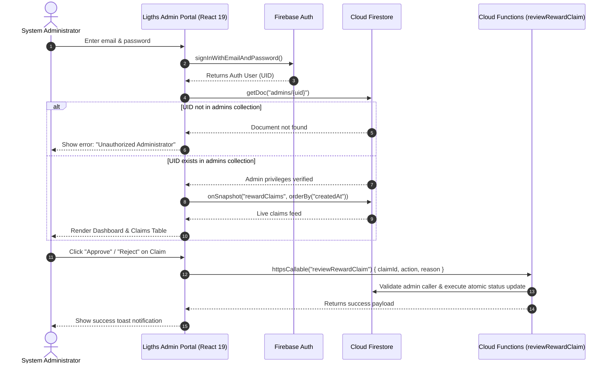

# 💡 LigthsON Project Ecosystem — Technical Documentation & Architecture Reference

> **Comprehensive System Documentation, Application Catalog, Webpage Directory, and Architectural Specifications**  
> *Project Version:* 1.0.0 | *Frameworks:* React Native (Expo 54), React 19 / Vite (Web), Firebase Functions v2  
> *Primary Currency & Locale:* Indian Rupee (`₹`), `en-IN` formatting  

---

## 📑 Table of Contents

1. [Executive Summary & File Analysis](#1-executive-summary--file-analysis)
   - [File Inventory by Extension](#11-file-inventory-by-extension)
   - [Summary of Applications](#12-summary-of-applications)
   - [Summary of Screens & Webpages](#13-summary-of-screens--webpages)
2. [End-to-End System Architecture](#2-end-to-end-system-architecture)
   - [High-Level Ecosystem Architecture Diagram](#21-high-level-ecosystem-architecture-diagram)
   - [Core Data & Communication Flow](#22-core-data--communication-flow)
3. [App 1: LigthsON Mobile Application](#3-app-1-ligthson-mobile-application)
   - [Technology Stack & Core Libraries](#31-technology-stack--core-libraries)
   - [Mobile Navigation & Stack Architecture Diagram](#32-mobile-navigation--stack-architecture-diagram)
   - [Complete Mobile Screen Directory (31 Screens)](#33-complete-mobile-screen-directory-31-screens)
   - [Global Add-on Widgets & Gates](#34-global-add-on-widgets--gates)
4. [App 2: Ligths Admin Web Portal (`web/ligthsweb`)](#4-app-2-ligths-admin-web-portal-webligthsweb)
   - [Overview & Technology Stack](#41-overview--technology-stack)
   - [Admin Portal Architecture & Data Flow Diagram](#42-admin-portal-architecture--data-flow-diagram)
   - [Admin Views & Component Hierarchy](#43-admin-views--component-hierarchy)
5. [App 3: Firebase Cloud Backend & Serverless Microservices (`functions/`)](#5-app-3-firebase-cloud-backend--serverless-microservices-functions)
   - [Cloud Functions v2 Architecture](#51-cloud-functions-v2-architecture)
   - [Authoritative Coin Economy Engine](#52-authoritative-coin-economy-engine)
   - [Reward Claim State Machine Diagram](#53-reward-claim-state-machine-diagram)
   - [Database Schema (Cloud Firestore)](#54-database-schema-cloud-firestore)
   - [Security Rules & Permission Matrix](#55-security-rules--permission-matrix)
6. [App 4: Interactive Prototype Suite & Design System (`prototypes/`)](#6-app-4-interactive-prototype-suite--design-system-prototypes)
   - [Overview & Server Architecture](#61-overview--server-architecture)
   - [Catalog of Prototype Concepts & Webpages (96 Pages)](#62-catalog-of-prototype-concepts--webpages-96-pages)
7. [External Third-Party Integrations](#7-external-third-party-integrations)
8. [Quality, Security & Engineering Standards](#8-quality-security--engineering-standards)

---

## 1. Executive Summary & File Analysis

### 1.1 File Inventory by Extension

A complete recursive scan of the workspace (excluding `node_modules` and `.git` caches) reveals **494 tracked files**:

| File Extension | File Count | Primary Purpose / Subsystem |
| :--- | :---: | :--- |
| **`.js`** | **160** | React Native mobile logic, services, utilities, Firebase Cloud Functions, local scripts |
| **`.mjs`** | **102** | Security tests, automated migration runners, penetration test suites |
| **`.html`** | **98** | Prototype web applications (95 concept pages + 1 launcher + 1 design spec + 1 admin web entry) |
| **`.md`** | **44** | Architecture docs, design specifications, changelogs, audit reports |
| **`.png`** | **30** | Brand assets, UI preview mockups, badges, app icons |
| **`.json`** | **20** | Project manifests (`package.json`, `app.json`), Firebase config, indexes, EAS build files |
| **`.css`** | **6** | CSS styles for web prototypes and Tailwind styles for the web admin dashboard |
| **`.svg`** | **5** | Vector brand logos, tab icons, status badges |
| **`.xml`** | **4** | Android build and resource manifests |
| **`.jpg`** | **4** | Photographic assets and splash imagery |
| **`.yml`** | **3** | GitHub Actions CI/CD workflows and automation pipelines |
| **`.jsx`** | **2** | Vite + React admin application views (`App.jsx`, `main.jsx`) |
| **`.rules`** | **2** | Production security definitions (`firestore.rules`, `storage.rules`) |
| **`.bat`** | **2** | Local Windows build helpers (`build-apk.bat`, `build-apk-eas.bat`) |
| **`.ttf`** | **2** | Custom typography font files (Space Grotesk, JetBrains Mono) |
| **`.txt`** | **1** | Build and crash debug log files |
| **`.xlsx`** | **1** | Purchasing Power Parity (PPP) empirical data reference |
| **`.zip`** | **1** | Packaged deployment distribution archive |
| **Other / No-ext**| **7** | Dotfiles, Git ignore, Firebase RC, editor configs |
| **Total Files** | **494** | **Clean production workspace** |

---

### 1.2 Summary of Applications

The repository contains **4 distinct software applications**:

```
┌────────────────────────────────────────────────────────────────────────────────────────┐
│                                   LIGHTSON ECOSYSTEM                                   │
├──────────────────┬───────────────────┬──────────────────────┬──────────────────────────┤
│ 📱 Mobile App    │ 💻 Admin Web      │ ☁️ Cloud Functions   │ 🎨 Prototype Suite       │
│ React Native     │ Vite + React 19   │ Node.js Firebase v2  │ Node.js / Express        │
│ Expo 54          │ Tailwind CSS v4   │ Authoritative Coins  │ 5 Design Concepts        │
│ iOS & Android    │ Governance Portal │ Security Triggers    │ 96 Interactive HTML Pages│
└──────────────────┴───────────────────┴──────────────────────┴──────────────────────────┘
```

1. **LigthsON Mobile Application (`/` & `src/`)**:
   - Flagship personal finance, investment management, and gamified wealth platform built with React Native (Expo 54) targeting Android and iOS with Web preview support.
2. **Ligths Admin Web Portal (`web/ligthsweb/`)**:
   - Modern administrative dashboard built with Vite, React 19, and Tailwind CSS. Connects directly to Firebase Auth and Cloud Functions to audit user balances, review reward redemptions, and approve/reject claims.
3. **Firebase Cloud Backend & Microservices (`functions/`)**:
   - Node.js serverless backend operating on Firebase Functions v2 (`us-central1`). Executes authoritative coin minting/penalties, idempotent Firestore transaction triggers, and secure username resolution.
4. **Interactive Prototype Webapps & Design Suite (`prototypes/`)**:
   - Standalone Node.js/Express preview server hosting 5 fully implemented fintech web application concepts (Digital Bank, Minimal Neobank, Enterprise Fintech, AI Finance, Luxury Wealth).

---

### 1.3 Summary of Screens & Webpages

Across the entire ecosystem, there are **129 total screen and webpage units**:

| Subsystem | Units | Breakdown Details |
| :--- | :---: | :--- |
| **Mobile App Screens** | **31** | 5 Auth Screens, 4 Home/Calendar Screens, 14 Wealth/Investment Screens, 2 Planning Screens, 3 AI/Report Screens, 4 Profile/Gamification Screens |
| **Mobile Global Overlays** | **2** | Floating AI Voice Assistant Widget (`VoiceAgentAddonWidget`), Biometric Security Gate (`AppLockGate`) |
| **Admin Web Views** | **2** | Dashboard Overview, Reward Claims Review Table (+ 3 functional drawers/modals) |
| **Admin Web Entry** | **1** | `web/ligthsweb/index.html` (Vite SPA mounting point) |
| **Design Specification** | **1** | `Design/pulse/Pulse.dc.html` (Design tokens & UI showcase) |
| **Prototype Webpages** | **96** | 5 Design Concepts × 19 HTML pages each + 1 Master Concept Launcher (`prototypes/index.html`) |
| **Total Screens & Webpages** | **129** | **Complete functional screen & view count** |

---

## 2. End-to-End System Architecture

### 2.1 High-Level Ecosystem Architecture Diagram

```mermaid
flowchart TB
    subgraph Clients["Frontend Clients"]
        Mobile["📱 LigthsON Mobile App\n(React Native / Expo 54)\n• iOS & Android Client\n• 31 Screens & AI Voice"]
        AdminWeb["💻 Ligths Admin Web Portal\n(Vite + React 19 + Tailwind)\n• Claims Review & Coin Audit\n• Secure Admin Workspace"]
        ProtoSuite["🎨 Prototype Showcase\n(Express + HTML5/CSS3/JS)\n• 5 Concept Webapps (96 Pages)\n• Design System Sandbox"]
    end

    subgraph ExternalAPIs["External Financial & Cloud Services"]
        MFAPI["📊 mfapi.in (AMFI)\nDaily Mutual Fund NAVs"]
        YahooFin["📈 Yahoo Finance API\nNSE & BSE Realtime Quotes"]
        ExpoPush["🔔 Expo Push Notification Service\nAPNs & FCM Relays"]
    end

    subgraph FirebaseCloud["Firebase Serverless Infrastructure"]
        Auth["🔐 Firebase Authentication\n• Email/Password & Biometrics\n• Custom Claims (Admin Role)"]
        
        subgraph FirestoreDB["Cloud Firestore (NoSQL)"]
            UsersCol["users/{uid}\n• Balance, streak, profile"]
            LedgersCol["users/{uid}/ledger\n• Income & Expense docs"]
            InvestCol["users/{uid}/investments\n• Stocks, MF, FD, RD, Savings"]
            ClaimsCol["rewardClaims/{claimId}\n• Status: pending, approved, completed"]
            AdminsCol["admins/{uid}\n• Whitelisted administrators"]
        end

        subgraph ServerlessFunctions["Firebase Cloud Functions v2 (Node.js)"]
            TrigLog["⚡ onDocumentCreated(ledger)\n• Auto-grant 10 coins (capped 20/day)"]
            TrigInvest["⚡ onDocumentCreated(investments)\n• Auto-grant 15-25 coins"]
            CallCheckIn["📞 dailyCheckIn()\n• 5 daily coins, 500 inactivity penalty"]
            CallClaim["📞 requestRewardClaim()\n• Deduct coins atomically, log claim"]
            CallReview["📞 reviewRewardClaim()\n• Admin approval/rejection/refund"]
        end

        Storage["🗄️ Cloud Storage\nUser receipts & generated PDFs"]
    end

    %% Mobile Connections
    Mobile -->|User Auth| Auth
    Mobile -->|Read/Write Data (Rules Enforced)| FirestoreDB
    Mobile -->|Trigger Cloud Functions| ServerlessFunctions
    Mobile -->|Fetch NAVs| MFAPI
    Mobile -->|Stock Quotes & Breakouts| YahooFin
    Mobile -->|Register Tokens| ExpoPush

    %% Admin Connections
    AdminWeb -->|Admin Login| Auth
    AdminWeb -->|Verify Admin & Sync Claims| AdminsCol
    AdminWeb -->|Listen to Claims| ClaimsCol
    AdminWeb -->|Approve/Reject/Refund| CallReview

    %% Functions to Firestore
    ServerlessFunctions -->|Atomic Transactions| UsersCol
    ServerlessFunctions -->|Idempotency Validation| ClaimsCol
```

---

### 2.2 Core Data & Communication Flow

1. **Transaction Logging & Coin Earning**:
   - User inputs an expense or income transaction via the mobile app (`Expenses.js` or `Income.js`).
   - The transaction writes to `users/{uid}/ledger/{id}`.
   - Firestore triggers the Cloud Function `onDocumentCreated`.
   - The Cloud Function executes an atomic transaction, verifying that the daily cap (20 entries) has not been exceeded, then increments the user's `coins` and records an immutable log in `users/{uid}/coinHistory`.
2. **Market Data Retrieval**:
   - Mutual fund holdings pull real-time NAV records directly from `https://api.mfapi.in/mf/`.
   - Equity portfolios and breakout screeners query Yahoo Finance (`query1.finance.yahoo.com`) with automated fallbacks to static Indian market datasets (`src/data/indianStocksData.js`).
3. **Reward Claim & Fulfillment**:
   - User redeems a reward on `CoinsScreen.js`.
   - Client calls `requestRewardClaim` Cloud Function.
   - Cloud Function atomically checks coin balance, deducts the coins, and creates a document in `/rewardClaims`.
   - The Admin Web Portal receives a real-time Firestore push update (`onSnapshot`).
   - The administrator reviews the claim and triggers `reviewRewardClaim` to either approve or reject (which refunds the coins back to the user).

---

## 3. App 1: LigthsON Mobile Application

*Path:* Root directory (`App.js`, `src/`)  
*Primary Platform:* Android (APK/AAB) & iOS (IPA) built using Expo Application Services (EAS)  
*Design System:* **Pulse / "Warm Precision"** (`src/theme/theme.js`)  

### 3.1 Technology Stack & Core Libraries

- **Core Framework:** React Native 0.81.5 with Expo SDK 54 (`expo@~54.0.37`)
- **Navigation:** React Navigation v7 (`@react-navigation/native`, `@react-navigation/stack`, `@react-navigation/bottom-tabs`)
- **State Management & Persistence:** React Context (`ThemeProvider`), `@react-native-async-storage/async-storage`, `expo-secure-store`
- **Security & Biometrics:** `expo-local-authentication`, `src/services/appLock.js`
- **UI & Animation Engine:** React Native Animated API, `react-native-screens`, `react-native-gesture-handler`, `lottie-react-native`
- **Charting & Data Visualization:** `react-native-svg` (15.12.1), `react-native-chart-kit`
- **Device Hardware & Audio:** `expo-speech`, `expo-av` (audio playback/recording for voice assistant)
- **Document Export:** `expo-print` & `expo-sharing` (PDF statement generation)

---

### 3.2 Mobile Navigation & Stack Architecture Diagram

```mermaid
graph TD
    Root[App.js: RootNavigator] --> Gate{AppLockGate Active?}
    Gate -->|Locked| BiometricPrompt[Biometric / PIN Screen]
    Gate -->|Unlocked| AuthCheck{User Authenticated?}

    AuthCheck -->|No| AuthStack[AuthNavigator]
    subgraph AuthStackGroup[Authentication Flow]
        AuthStack --> Onboarding[1. OnboardingScreen]
        AuthStack --> Splash[2. SplashScreen]
        AuthStack --> Login[3. LoginScreenView]
        AuthStack --> SignUp[4. RegisterScreen]
        AuthStack --> ForgotPass[5. ForgotPasswordScreen]
    end

    AuthCheck -->|Yes| MainApp[MainApp: Bottom Tab Dock]
    
    subgraph TabDockGroup[Bottom Tab Navigation]
        MainApp --> TabHome[Home Tab\nCalendarStackNavigator]
        MainApp --> TabWealth[Wealth Tab\nWealthStackNavigator]
        MainApp --> TabVoice[Voice Tab Action\nVoiceAgentAddonWidget]
        MainApp --> TabPlan[Plan Tab\nPlanStackNavigator]
        MainApp --> TabMe[Me Tab\nMeStackNavigator]
    end

    subgraph HomeStackGroup[Home / Calendar Stack]
        TabHome --> CalMain[6. CalendarMain]
        TabHome --> DateExp[7. DateExpenses]
        TabHome --> IncScreen[8. Income]
        TabHome --> ExpScreen[9. Expenses]
        TabHome --> RepScreen[25. ReportScreen]
        TabHome --> WkRecap[26. WeekRecap]
        TabHome --> NoteAI[24. NoteAIScreen]
    end

    subgraph WealthStackGroup[Wealth & Investment Stack]
        TabWealth --> WealthHome[10. WealthScreen]
        TabWealth --> InvNav[11. InvestmentNavigation]
        TabWealth --> FDScreen[12. FDScreen]
        TabWealth --> RDScreen[13. RDScreen]
        TabWealth --> SavingsScreen[14. SavingsScreen]
        TabWealth --> MFPortfolio[15. MFPortfolioScreen]
        TabWealth --> MFHolding[16. MFHoldingScreen]
        TabWealth --> MFScreen[17. MFScreen]
        TabWealth --> MFCalc[18. MFCalculator]
        TabWealth --> StocksHome[19. StocksScreen]
        TabWealth --> BreakoutScreen[20. BreakoutStocksScreen]
        TabWealth --> StockSearch[21. StockSearchScreen]
        TabWealth --> StockDetail[22. StockDetailScreen]
    end

    subgraph PlanStackGroup[Plan Stack: Segmented Control]
        TabPlan --> FireNum[23. FireNumber]
        TabPlan --> GoalCalc[24. GoalCalculator]
    end

    subgraph MeStackGroup[Me / Profile Stack]
        TabMe --> ProfileHome[27. Profile]
        TabMe --> CoinsHome[28. CoinsScreen]
        TabMe --> BadgesHome[29. BadgesScreen]
        TabMe --> ClaimsHome[30. MyRewardClaimsScreen]
    end
```



---

### 3.3 Complete Mobile Screen Directory (31 Screens)

Below is the exhaustive catalog of all 31 functional mobile screens located in `src/screens/`:

#### A. Authentication & Onboarding Domain (`src/screens/auth/`)
1. **`SplashScreen.js`**  
   - *Route:* `SplashScreen`  
   - *Role:* Initial application boot screen; validates stored session tokens in `expo-secure-store`, initializes fonts, and redirects to `Login` or `MainApp`.
2. **`onboardingScreen.js`**  
   - *Route:* `Onboarding`  
   - *Role:* Multi-card interactive carousel presenting LigthsON's core value pillars (Expense Tracking, Wealth Building, F.I.R.E. Goals, AI Voice). Sets `hasSeenOnboarding` in AsyncStorage.
3. **`LoginScreenView.js`**  
   - *Route:* `Login`  
   - *Role:* Dual-mode login interface supporting Email or Username authentication via Cloud Functions, with integrated Biometric FaceID/Fingerprint quick sign-in.
4. **`RegisterScreen.js`**  
   - *Route:* `SignUp`  
   - *Role:* New user registration flow creating Firebase Auth credentials, initializing the default Firestore user profile document, and seeding starting coin balances.
5. **`ForgotPasswordScreen.js`**  
   - *Route:* `ForgotPassword`  
   - *Role:* Password recovery screen dispatching Firebase Auth password reset emails with client-side validation.

#### B. Transactions & Calendar Domain (`src/screens/calendar/` & `src/screens/transactions/`)
6. **`calendarmain.js`**  
   - *Route:* `CalendarMain` (Default Home Tab Landing)  
   - *Role:* Core calendar dashboard displaying daily financial health indicators, streak tracking, monthly expense vs. income aggregates, and quick logging buttons.
7. **`dateExpenses.js`**  
   - *Route:* `DateExpenses`  
   - *Role:* Detailed day breakdown displaying all transactions executed on a selected calendar date with categorization icons, edit capabilities, and deletion handling.
8. **`Income.js`**  
   - *Route:* `Income`  
   - *Role:* Dedicated income logging interface supporting categories (Salary, Freelance, Dividend, Rental), payment modes, date pickers, and recurring income tags.
9. **`Expenses.js`**  
   - *Route:* `Expenses`  
   - *Role:* Comprehensive expense logging interface with dynamic category selectors (Food, Shopping, Housing, Utilities), notes, payment accounts, and receipt metadata.

#### C. Wealth & Portfolio Domain (`src/screens/wealth/`)
10. **`WealthScreen.js`**  
    - *Route:* `WealthHome` (Wealth Tab Root)  
    - *Role:* Unified net worth command center aggregating holdings across Equities, Mutual Funds, Fixed Deposits, Recurring Deposits, and Liquid Cash with asset allocation charts.
11. **`MFPortfolioScreen.js`**  
    - *Route:* `MFPortfolio`  
    - *Role:* Aggregated Mutual Fund portfolio view illustrating total invested value, current market valuation, overall XIRR, and allocation by AMC/market cap.
12. **`MFHoldingScreen.js`**  
    - *Route:* `MFHolding`  
    - *Role:* Granular detail view for a specific mutual fund holding; plots historical scheme NAVs fetched from `mfapi.in`, transaction history, and unrealized gains.

#### D. Investment Management Domain (`src/screens/investments/`)
13. **`InvestmentNavigation.js`**  
    - *Route:* `Investment` / `AddInvestment`  
    - *Role:* Central routing hub presenting investment instrument cards (Stocks, Mutual Funds, FD, RD, Emergency Fund) to initiate logging.
14. **`FDScreen.js`**  
    - *Route:* `FDScreen`  
    - *Role:* Fixed Deposit portfolio tracker and maturity calculator calculating compound interest, bank name, tenure, and maturity date.
15. **`RDScreen.js`**  
    - *Route:* `RDScreen`  
    - *Role:* Recurring Deposit tracker monitoring monthly installment schedules, accumulated balance, and projected returns.
16. **`SavingsScreen.js`**  
    - *Route:* `SavingsScreen`  
    - *Role:* Liquid cash and emergency fund monitor; calculates the user's runway (number of months survivable without income based on average burn).
17. **`MFScreen.js`**  
    - *Route:* `MFScreen`  
    - *Role:* Mutual fund entry logger supporting SIP (Systematic Investment Plan) and Lumpsum logging with live AMFI scheme search.
18. **`MFCalculator.js`**  
    - *Route:* `MFCalculator`  
    - *Role:* Investment projection calculator showing future wealth accumulation based on monthly investment, expected return percentage, and duration.
19. **`StocksScreen.js`**  
    - *Route:* `StocksScreen`  
    - *Role:* Direct equity tracker displaying live Indian stock holdings (NSE/BSE), total portfolio P&L, day change, and watchlist toggle.
20. **`StockDetailScreen.js`**  
    - *Route:* `StockDetail`  
    - *Role:* Comprehensive stock deep-dive providing interactive timeframe charts (1D, 1W, 1M, 1Y, 5Y), market statistics, 52-week highs/lows, and company fundamentals.
21. **`StockSearchScreen.js`**  
    - *Route:* `StockSearch`  
    - *Role:* Real-time stock search interface with fuzzy matching across thousands of listed Indian companies on NSE and BSE.
22. **`BreakoutStocksScreen.js`**  
    - *Route:* `BreakoutStocksScreen`  
    - *Role:* Premium feature screen analyzing price momentum and volume spikes to surface potential breakout stocks; gated by coin unlock mechanics.

#### E. Planning & Calculators Domain (`src/screens/investments/`)
23. **`FireNumber.js`**  
    - *Route:* `FireNumber` (Plan Tab Primary)  
    - *Role:* Financial Independence Retire Early (F.I.R.E.) planner calculating Lean FIRE, Standard FIRE, and Fat FIRE milestone targets based on annual expenses and withdrawal rates.
24. **`GoalCalculator.js`**  
    - *Route:* `Goals` (Plan Tab Secondary via Segmented Header)  
    - *Role:* Goal-based savings engine enabling users to plan major life milestones (Home Purchase, Vehicle, Education, Vacation) with required monthly contributions.

#### F. AI & Analytics Domain (`src/screens/ai/` & `src/screens/reports/`)
25. **`noteaiscreen.js`**  
    - *Route:* `NoteAIScreen`  
    - *Role:* Smart financial notepad powered by AI audio transcription and natural language parsing to extract structured ledger entries from spoken or typed notes.
26. **`ReportScreen.js`**  
    - *Route:* `ReportScreen`  
    - *Role:* Comprehensive financial reporting suite offering month-over-month comparisons, category pie charts, cash flow velocity, and exportable PDF statements.
27. **`WeekRecap.js`**  
    - *Route:* `WeekRecap`  
    - *Role:* Automated weekly financial health review highlighting top spending categories, savings rate, and rewarding consistent habits with bonus coins.

#### G. Profile, Gamification & Rewards Domain (`src/screens/profile/`)
28. **`Profile.js`**  
    - *Route:* `ProfileHome` (Me Tab Root)  
    - *Role:* User account headquarters managing app theme (Light/Dark/Auto), biometric App Lock toggle, Privacy Mode (hides balances), notification preferences, and account logout.
29. **`CoinsScreen.js`**  
    - *Route:* `Coins`  
    - *Role:* Gamified coin wallet displaying current coin balance, daily check-in streak calendar, detailed coin earning history, and the Premium Rewards store.
30. **`BadgesScreen.js`**  
    - *Route:* `BadgesScreen`  
    - *Role:* Visual showcase of unlocked and locked achievement badges commemorating financial milestones (e.g., 30-Day Streak, First Stock Logged, FIRE Halfway).
31. **`MyRewardClaimsScreen.js`**  
    - *Route:* `MyRewardClaims`  
    - *Role:* Status tracker for redeemed premium rewards (e.g., Stock Recommendation or Consultation Call) displaying live fulfillment progress (`pending`, `approved`, `completed`, `rejected`).

---

### 3.4 Global Add-on Widgets & Gates

- **`VoiceAgentAddonWidget.js` (`src/components/VoiceAgentAddonWidget.js`)**:
  - Global floating/docked voice assistant accessible from the bottom navigation bar.
  - Features real-time voice recording via `expo-av`, conversational intent parsing, speech feedback via `expo-speech`, and conversational ledger logging.
- **`AppLockGate.js` (`src/components/AppLockGate.js`)**:
  - App-wide biometric shield that triggers whenever the app transitions from background to active if `appLock` is enabled in user settings.
  - Utilizes `expo-local-authentication` to challenge with FaceID, TouchID, or device passcode.

---

## 4. App 2: Ligths Admin Web Portal (`web/ligthsweb`)

*Path:* `web/ligthsweb/`  
*Primary Platform:* Web (Modern Desktop & Tablet Browsers)  
*Tech Stack:* Vite 8, React 19, Tailwind CSS v4, Lucide Icons, Firebase JS SDK 10  

### 4.1 Overview & Technology Stack

The Admin Web Portal provides a zero-trust administrative dashboard for financial administrators to review, approve, reject, or fulfill user reward claims, and monitor system-wide coin activity without needing access to the raw Firebase Console.

- **Build Tool:** Vite (`vite.config.js` with `@vitejs/plugin-react`)
- **Styling:** Tailwind CSS v4 (`@tailwindcss/vite`)
- **Icons:** `lucide-react`
- **Security Check:** Validates against the `admins/{uid}` collection; non-admins are blocked client-side and server-side.

---

### 4.2 Admin Portal Architecture & Data Flow Diagram



---

### 4.3 Admin Views & Component Hierarchy

The application resides in `web/ligthsweb/src/App.jsx` structured into modular functional states:

1. **Authentication Gate View**:
   - High-security login card validating admin credentials and enforcing authorization against Firestore `/admins` records.
2. **Dashboard Overview Tab (`activeTab === 'dashboard'`)**:
   - Top KPI metrics cards: Total Claims Received, Pending Review, Approved, Completed, and Total Coins Burned.
   - Recent activity list highlighting urgent unfulfilled claims.
3. **Claims Management Table Tab (`activeTab === 'claims'`)**:
   - Full interactive data table with live Firestore updates (`onSnapshot`).
   - Multi-parameter search (by User Email, User Name, Claim ID, Reward Name).
   - Filter chips: `All`, `Pending`, `Approved`, `Completed`, `Rejected`.
   - Dynamic sorting: `Newest First`, `Oldest First`, `Highest Coins`.
   - Paginated table rows (8 items per page) with action shortcuts.
4. **Claim Detail Drawer (Modal)**:
   - Slide-over panel displaying complete user contact details (Phone, Email, Full Name), requested reward metadata, creation timestamp, and fulfillment timeline.
5. **Rejection Modal with Refund Logic**:
   - Dialogue requiring a mandatory reason for rejection; communicates with the server to refund the redeemed coins back into the user's wallet.
6. **Confirmation Dialogs**:
   - Double-confirmation prompts for approving claims or marking consultation calls as completed.

---

## 5. App 3: Firebase Cloud Backend & Serverless Microservices (`functions/`)

*Path:* `functions/`  
*Primary Platform:* Firebase Functions v2 (`node.js` 18/20 runtime)  
*Region:* `us-central1`  

### 5.1 Cloud Functions v2 Architecture

The backend handles all business-critical operations that cannot be trusted to client devices, primarily the **Coin Economy**, **Idempotent Rewards**, and **Administrative Verification**.

| Function Identifier | Trigger Type | Execution Purpose |
| :--- | :--- | :--- |
| **`onLedgerCreated`** | Firestore `onDocumentCreated("users/{uid}/ledger/{id}")` | Awards 10 coins for logging income or expenses; enforces a strict daily limit of 20 rewarded logs per calendar day. |
| **`onInvestmentCreated`** | Firestore `onDocumentCreated("users/{uid}/investments/{id}")` | Awards 15–25 coins based on the investment type (Savings: 15, FD/RD: 20, MF/Stocks: 25). |
| **`dailyCheckIn`** | HTTPS Callable (`onCall`) | Validates user's Indian Standard Time (IST) calendar day; awards 5 coins for opening the app; applies 500-coin inactivity penalty if inactive for >7 days. |
| **`requestRewardClaim`** | HTTPS Callable (`onCall`) | Atomically deducts coins from the user's balance and creates an unfulfilled record in `/rewardClaims`. |
| **`reviewRewardClaim`** | HTTPS Callable (`onCall`) | Admin-only function to approve, complete, or reject a claim (with automatic coin refunds upon rejection). |
| **`resolveUsernameToEmail`** | HTTPS Callable (`onCall`) | Resolves user handles to emails server-side to prevent exposing the `/users` table to public queries. |

---

### 5.2 Authoritative Coin Economy Engine

Coins serve as the core gamification asset driving daily user retention. To prevent fraud, client applications have **zero direct write permissions** to coin balances.

```
┌────────────────────────────────────────────────────────────┐
│                    COIN INCENTIVE RULES                    │
├───────────────────────────────┬────────────────────────────┤
│ Action                        │ Coin Delta                 │
├───────────────────────────────┼────────────────────────────┤
│ Daily App Open                │ +5 coins                   │
│ Log Income                    │ +10 coins (Max 20/day)     │
│ Log Expense                   │ +10 coins (Max 20/day)     │
│ Log Savings Investment        │ +15 coins                  │
│ Log FD / RD Investment        │ +20 coins                  │
│ Log Stocks / Mutual Funds     │ +25 coins                  │
│ Inactivity (> 7 Days)         │ -500 coins penalty         │
│ Redeem Stock Recommendation   │ -10,000 coins              │
│ Redeem Free Consultation Call │ -75,000 coins              │
└───────────────────────────────┴────────────────────────────┘
```

---

### 5.3 Reward Claim State Machine Diagram

```mermaid
stateDiagram-v2
    [*] --> Pending: User submits claim\n(requestRewardClaim)
    
    state Pending {
        note right of Pending: Coins deducted atomically\nStatus = 'pending'
    }

    Pending --> Approved: Admin reviews & validates\n(reviewRewardClaim: 'approve')
    Pending --> Rejected: Admin rejects\n(reviewRewardClaim: 'reject')

    state Rejected {
        note right of Rejected: Coins refunded to user\nRejection reason logged
    }

    state Approved {
        note right of Approved: Stock report or call scheduled\nStatus = 'approved'
    }

    Approved --> Completed: Consultation delivered\n(reviewRewardClaim: 'complete')

    Completed --> [*]
    Rejected --> [*]
```

---

### 5.4 Database Schema (Cloud Firestore)

```
/users/{uid}                           <-- User document (profile, coins, streak, privacy)
    ├── /ledger/{entryId}              <-- Income & Expense entries
    ├── /investments/{invId}           <-- Stock, MF, FD, RD records
    ├── /coinHistory/{key}             <-- Immutable coin earning/spending log
    ├── /coinDaily/{YYYY-MM-DD}        <-- Daily transaction counter for capping
    └── /notifications/{notifId}       <-- User in-app notification alerts

/rewardClaims/{claimId}                <-- Global reward redemptions queue
    ├── uid: string
    ├── rewardType: string
    ├── coinsDeducted: number
    ├── status: "pending" | "approved" | "completed" | "rejected"
    ├── rejectionReason: string | null
    └── createdAt: timestamp

/admins/{uid}                          <-- Whitelisted admin UID documents
```

---

### 5.5 Security Rules & Permission Matrix

Defined in `firestore.rules`:
- **Users Collection:** Authenticated users can only read and write documents inside their own subtree (`request.auth.uid == userId`).
- **Coin Balance Protection:** The `coins` property on `/users/{uid}` cannot be modified directly by client write requests; only trusted Cloud Functions utilizing `firebase-admin` bypass rules to update balances.
- **Admin Verification:** Access to global claims is restricted to accounts existing in `/admins/$(request.auth.uid)`.

---

## 6. App 4: Interactive Prototype Suite & Design System (`prototypes/`)

*Path:* `prototypes/`  
*Primary Platform:* Web (Cross-browser HTML5/CSS3/Vanilla JS)  
*Server:* `prototypes/server.js` (Express Server on port 3000)  

### 6.1 Overview & Server Architecture

To facilitate rapid UX experimentation, client feedback, and design iteration without needing React Native builds, the repository includes a standalone prototype suite containing **5 distinct concept designs**.

- **Launcher:** `prototypes/server.js` serves the prototype suite locally with live static routing and zero external build steps.
- **Index Hub:** `prototypes/index.html` acts as a switcher to preview any concept side-by-side.

---

### 6.2 Catalog of Prototype Concepts & Webpages (96 Pages)

Each concept directory replicates the complete LigthsON experience in a distinct visual philosophy:

1. **`Concept-1-Premium-Digital-Bank/` (19 HTML Pages)**:
   - High-contrast, institutional digital banking interface with emerald accents and structured cards.
2. **`Concept-2-Minimal-Neobank/` (19 HTML Pages)**:
   - Monochromatic, ultra-clean aesthetic inspired by contemporary European neobanks.
3. **`Concept-3-Enterprise-Fintech/` (19 HTML Pages)**:
   - Information-dense data tables, financial charts, and advanced portfolio analytics.
4. **`Concept-4-AI-Powered-Finance/` (19 HTML Pages)**:
   - Conversational-first interface highlighting predictive cash flows and AI voice insights.
5. **`Concept-5-Luxury-Wealth/` (19 HTML Pages)**:
   - Elegant dark theme with gold and champagne accents tailored for high-net-worth portfolio tracking.
6. **Master Prototype Launcher (`prototypes/index.html`) (1 HTML Page)**:
   - The interactive entry point allowing developers and designers to launch any of the 5 concepts.

#### The 19 Standard Webpages in Each Prototype Concept:
| # | Page File | Functionality Replicated |
| :-: | :--- | :--- |
| 1 | `index.html` | Concept landing page & brand onboarding |
| 2 | `dashboard.html` | Main financial summary & daily status |
| 3 | `income.html` | Income entry ledger |
| 4 | `expenses.html` | Expense tracker & category breakdowns |
| 5 | `calendar.html` | Interactive calendar heatmaps & logs |
| 6 | `investments.html`| Investments hub & portfolio totals |
| 7 | `mutualfunds.html`| Mutual fund tracker & SIP projections |
| 8 | `stocks.html` | Stock holdings & live watchlist |
| 9 | `fire.html` | F.I.R.E. retirement roadmap calculator |
| 10 | `goals.html` | Goal-based financial milestone tracker |
| 11 | `reports.html` | Monthly analytics & exportable graphs |
| 12 | `ai-assistant.html`| Conversational financial bot interface |
| 13 | `ai-notes.html` | Smart voice & text financial notepad |
| 14 | `rewards.html` | Coin balance & redeemable reward store |
| 15 | `badges.html` | Gamified achievement showcase |
| 16 | `profile.html` | User account settings & tier status |
| 17 | `settings.html` | Security, biometric & currency controls |
| 18 | `notifications.html`| In-app notification alerts list |
| 19 | `design-system.html`| Complete atomic component & typography palette |

*(5 concepts × 19 pages = 95 pages + 1 launcher = **96 Prototype HTML Webpages**)*

---

## 7. External Third-Party Integrations

```mermaid
flowchart LR
    App["LigthsON Application"]
    
    subgraph MarketData["Live Market Data"]
        AMFI["MFAPI (api.mfapi.in)\n• Scheme NAV History\n• AMC Metadata"]
        Yahoo["Yahoo Finance API\n• NSE (^NSEI) & BSE (^BSESN)\n• Realtime Quotes & History"]
    end

    subgraph Messaging["Communications"]
        ExpoGateway["Expo Push Service\n• Daily reminder triggers\n• Streak alerts"]
    end

    App -->|HTTP GET /mf/{schemeCode}| AMFI
    App -->|HTTP GET /v8/finance/chart/| Yahoo
    App -->|POST /api/v2/push/send| ExpoGateway
```

1. **AMFI Mutual Funds (`src/services/mfService.js`)**:
   - Queries `https://api.mfapi.in/mf` to retrieve official Association of Mutual Funds in India (AMFI) NAVs without requiring paid API keys.
2. **Yahoo Finance (`src/services/yahooFinanceService.js`)**:
   - Fetches historical candlesticks, quote summaries, and market capitalization metrics for Indian equities.
3. **Expo Push Notifications (`src/services/notificationService.js`)**:
   - Schedules daily reminders for expense logging and streak maintenance via local device notifications and the Expo Push gateway.

---

## 8. Quality, Security & Engineering Standards

- **Monetary Precision:** All monetary amounts are formatted according to the Indian numbering format (lakhs and crores: `₹1,00,000.00`) using `src/utils/formatters.js`.
- **Zero Inline Hex Colors:** Follows the "Warm Precision" design tokens located in `src/theme/theme.js` across all React Native screens.
- **Biometric Security:** User session state and encryption keys are stored securely using `expo-secure-store` and guarded by `AppLockGate.js`.
- **Production Rules:** Cloud Firestore security rules strictly block client-side modification of coins, user privilege escalation, and unauthorized access to claims.
