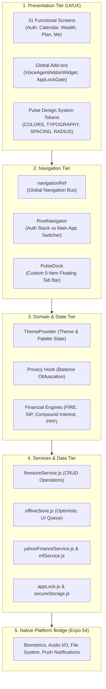
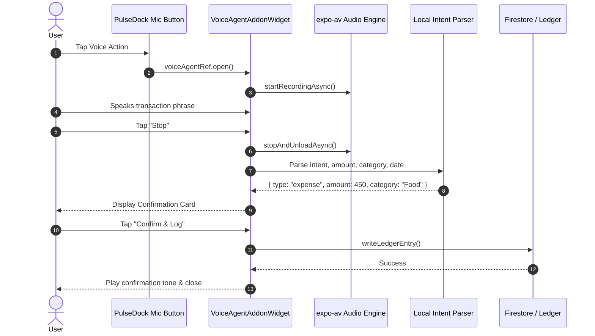

# 📱 LigthsON Mobile Application — Technical Architecture & System Specification

```
═══════════════════════════════════════════════════════════════════════════════════════════
  DOCUMENT TITLE:      LigthsON Mobile Application — Software Architecture Document (SAD)
  VERSION:             1.0.0 (Production Release)
  PLATFORMS:           Android (API 24+) & iOS (15.0+) | Expo SDK 54 / React Native 0.81.5
  CLASSIFICATION:      Technical Documentation & Engineering Submission
  LAST UPDATED:        October 2026
  PRIMARY LOCALE:      en-IN (Currency: Indian Rupee ₹)
═══════════════════════════════════════════════════════════════════════════════════════════
```

---

## 📑 Table of Contents

1. [Executive Summary](#1-executive-summary)
2. [Business & Architectural Objectives](#2-business--architectural-objectives)
3. [System Architecture Overview](#3-system-architecture-overview)
   - [3.1 High-Level Mobile Application Architecture](#31-high-level-mobile-application-architecture)
   - [3.2 Layered Architectural Pattern](#32-layered-architectural-pattern)
4. [Navigation & Information Architecture (IA)](#4-navigation--information-architecture-ia)
   - [4.1 Routing Hierarchy & Stack Organization](#41-routing-hierarchy--stack-organization)
   - [4.2 Navigation Tree Flowchart](#42-navigation-tree-flowchart)
5. [Complete Mobile Screen Directory (31 Functional Screens)](#5-complete-mobile-screen-directory-31-functional-screens)
   - [5.1 Module A: Authentication & Onboarding (5 Screens)](#51-module-a-authentication--onboarding-5-screens)
   - [5.2 Module B: Calendar & Daily Cash Flow (4 Screens)](#52-module-b-calendar--daily-cash-flow-4-screens)
   - [5.3 Module C: Wealth & Asset Allocation (3 Screens)](#53-module-c-wealth--asset-allocation-3-screens)
   - [5.4 Module D: Investment Management Suite (10 Screens)](#54-module-d-investment-management-suite-10-screens)
   - [5.5 Module E: F.I.R.E. & Goal Planning (2 Screens)](#55-module-e-fire--goal-planning-2-screens)
   - [5.6 Module F: Financial Analytics & AI Reports (3 Screens)](#56-module-f-financial-analytics--ai-reports-3-screens)
   - [5.7 Module G: Profile, Rewards & Gamification (4 Screens)](#57-module-g-profile-rewards--gamification-4-screens)
6. [Global Application Overlays & System Gates](#6-global-application-overlays--system-gates)
   - [6.1 Conversational AI Voice Assistant Widget](#61-conversational-ai-voice-assistant-widget)
   - [6.2 Biometric App Lock Security Gate](#62-biometric-app-lock-security-gate)
7. [State Management, Persistence & Offline Sync Engine](#7-state-management-persistence--offline-sync-engine)
   - [7.1 Storage Tiers](#71-storage-tiers)
   - [7.2 Offline Synchronization Lifecycle](#72-offline-synchronization-lifecycle)
8. [External Financial APIs & Service Integration](#8-external-financial-apis--service-integration)
9. [Design System & "Warm Precision" UI Tokens](#9-design-system--warm-precision-ui-tokens)
10. [Application Security & Privacy Architecture](#10-application-security--privacy-architecture)
11. [Build, Release & Environment Pipeline](#11-build-release--environment-pipeline)

---

## 1. Executive Summary

**LigthsON** is a high-performance, cross-platform personal finance, wealth tracking, and gamified financial planning mobile application engineered using **React Native 0.81.5** and the **Expo SDK 54** runtime. Designed specifically for the Indian financial ecosystem, the platform bridges daily expense accounting, live market investment tracking (NSE/BSE equities, AMFI mutual funds, fixed and recurring deposits), milestone planning (Financial Independence, Retire Early - F.I.R.E.), and habit gamification into a unified mobile client.

This document serves as the formal **Software Architecture Document (SAD)** for the **mobile application client**. It details the structural design, data flow, screen-by-screen specifications, security controls, and design system governance implemented in production.

---

## 2. Business & Architectural Objectives

| Objective | Architectural Implementation |
| :--- | :--- |
| **Monetary Precision & Locale** | Full compliance with the `en-IN` numbering system (lakhs/crores) and zero-drift floating-point financial arithmetic. |
| **High Daily Retention** | An authoritative server-governed coin economy with streaks, activity milestones, and inactivity penalties. |
| **Offline-First Resilience** | Local write queuing using asynchronous client storage and seamless background synchronization with Cloud Firestore. |
| **Zero-Friction Logging** | Hybrid text and speech-to-intent transaction entry via an integrated AI voice agent. |
| **Zero-Trust Client Security** | Biometric gates (FaceID/Fingerprint), hardware-backed keystore token encryption (`expo-secure-store`), and privacy mode toggling. |
| **Fluid Responsiveness** | Native 60 FPS transitions using hardware-accelerated drivers, gesture handlers, and layout scaling based on device viewport metrics. |

---

## 3. System Architecture Overview

### 3.1 High-Level Mobile Application Architecture

The mobile app operates as a self-contained client that communicates securely with serverless cloud services, live market data endpoints, and device hardware APIs.

```mermaid
flowchart TB
    subgraph MobileDevice["📱 LigthsON Mobile Client (React Native 0.81 / Expo 54)"]
        direction TB
        UI["Presentation Layer\n(React Navigation 7 / Pulse UI Components)"]
        BL["Business Logic Layer\n(Calculators, Portfolio Valuation, Streak Logic)"]
        Cache["Local Persistence Layer\n(AsyncStorage & Expo SecureStore)"]
        Voice["Voice Agent Engine\n(expo-av & expo-speech)"]
        Biometrics["Biometric Gate\n(expo-local-authentication)"]

        UI <--> BL
        BL <--> Cache
        UI <--> Voice
        UI <--> Biometrics
    end

    subgraph FirebaseCloud["☁️ Firebase Cloud Infrastructure"]
        AuthSvc["Firebase Auth\n(Identity & Custom Claims)"]
        FirestoreSvc["Cloud Firestore\n(User Ledgers, Portfolios, Claims)"]
        CloudFuncs["Cloud Functions v2\n(Authoritative Coin Minting & Checks)"]
        StorageSvc["Cloud Storage\n(Receipts & PDF Reports)"]
    end

    subgraph ExternalServices["🌐 External Financial Services"]
        AMFI["AMFI NAV Service\n(api.mfapi.in)"]
        YahooFinance["Yahoo Finance Engine\n(NSE / BSE Quotes & Breakouts)"]
        ExpoPush["Expo Push Relay\n(APNs & FCM Notifications)"]
    end

    %% Client to Backend
    BL -->|JWT Token Session| AuthSvc
    BL -->|Realtime Subscriptions & Offline Sync| FirestoreSvc
    BL -->|HTTPS Callable Functions| CloudFuncs
    BL -->|Exported Statements| StorageSvc

    %% Client to External APIs
    BL -->|Fetch Historical NAVs| AMFI
    BL -->|Live Market Equities| YahooFinance
    BL -->|Register Push Token| ExpoPush
```



---

### 3.2 Layered Architectural Pattern

The application is structured into five cohesive, decoupled architectural tiers:



---

## 4. Navigation & Information Architecture (IA)

### 4.1 Routing Hierarchy & Stack Organization

The navigation tree is driven by **React Navigation v7** with declarative type-safe navigation refs. The root level evaluates authentication and biometric gate status before routing into one of two top-level stacks:

1. **`AuthNavigator`**: An unauthenticated stack comprising Onboarding, Splash, Login, Registration, and Password Reset.
2. **`MainApp`**: The primary authenticated container featuring a persistent bottom navigation bar (**PulseDock**) housing 4 primary stacks and 1 global voice action button:
   - **Home Tab (`CalendarStackNavigator`):** Daily transaction calendar, income/expense logging, weekly recaps, and AI financial notes.
   - **Wealth Tab (`WealthStackNavigator`):** Net worth overview, investment hub, equity portfolios, mutual funds, FDs, RDs, and savings.
   - **Voice Action (`AIVoice`):** Central interactive mic trigger opening the floating voice assistant drawer.
   - **Plan Tab (`PlanStackNavigator`):** Segmented navigation between F.I.R.E. retirement roadmaps and customizable goal calculators.
   - **Me Tab (`MeStackNavigator`):** User profile, gamification coin wallet, achievement badges, redeemed reward tracking, and security settings.

---

### 4.2 Navigation Tree Flowchart

```mermaid
graph TD
    AppBoot([App Launch]) --> BiometricGate{Biometric Lock Enabled?}
    BiometricGate -->|Yes| LockScreen[AppLockGate Challenge]
    BiometricGate -->|No| AuthCheck{Active User Token?}
    LockScreen -->|Verified| AuthCheck

    AuthCheck -->|No| AuthStack[Auth Stack Navigator]
    subgraph AuthGroup["Auth Navigator"]
        AuthStack --> S1[1. OnboardingScreen]
        AuthStack --> S2[2. SplashScreen]
        AuthStack --> S3[3. LoginScreenView]
        AuthStack --> S4[4. RegisterScreen]
        AuthStack --> S5[5. ForgotPasswordScreen]
    end

    AuthCheck -->|Yes| MainApp[MainApp: Bottom Tab Dock]

    subgraph TabGroup["Bottom Navigation Dock (PulseDock)"]
        MainApp --> Tab1[Home Tab]
        MainApp --> Tab2[Wealth Tab]
        MainApp --> Tab3[Voice Button]
        MainApp --> Tab4[Plan Tab]
        MainApp --> Tab5[Me Tab]
    end

    subgraph HomeStack["Home Stack (CalendarStackNavigator)"]
        Tab1 --> S6[6. CalendarMain]
        Tab1 --> S7[7. DateExpenses]
        Tab1 --> S8[8. Income]
        Tab1 --> S9[9. Expenses]
        Tab1 --> S25[25. ReportScreen]
        Tab1 --> S26[26. WeekRecap]
        Tab1 --> S24[24. NoteAIScreen]
    end

    subgraph WealthStack["Wealth Stack (WealthStackNavigator)"]
        Tab2 --> S10[10. WealthScreen]
        Tab2 --> S11[11. InvestmentNavigation]
        Tab2 --> S12[12. FDScreen]
        Tab2 --> S13[13. RDScreen]
        Tab2 --> S14[14. SavingsScreen]
        Tab2 --> S15[15. MFPortfolioScreen]
        Tab2 --> S16[16. MFHoldingScreen]
        Tab2 --> S17[17. MFScreen]
        Tab2 --> S18[18. MFCalculator]
        Tab2 --> S19[19. StocksScreen]
        Tab2 --> S20[20. BreakoutStocksScreen]
        Tab2 --> S21[21. StockSearchScreen]
        Tab2 --> S22[22. StockDetailScreen]
    end

    subgraph VoiceGroup["Global Action"]
        Tab3 --> VoiceDrawer[VoiceAgentAddonWidget Modal]
    end

    subgraph PlanStack["Plan Stack (PlanStackNavigator)"]
        Tab4 --> S23[23. FireNumber]
        Tab4 --> S24Plan[24. GoalCalculator]
    end

    subgraph MeStack["Me Stack (MeStackNavigator)"]
        Tab5 --> S27[27. Profile]
        Tab5 --> S28[28. CoinsScreen]
        Tab5 --> S29[29. BadgesScreen]
        Tab5 --> S30[30. MyRewardClaimsScreen]
    end
```



---

## 5. Complete Mobile Screen Directory (31 Functional Screens)

Every screen is implemented as a modular functional component styled using design tokens from `src/theme/theme.js`.

---

### 5.1 Module A: Authentication & Onboarding (5 Screens)

#### 1. `SplashScreen.js`
- **Source Path:** [`src/screens/auth/SplashScreen.js`](file:///f:/MASTER/Lights%20Intent/ligths-main-main/src/screens/auth/SplashScreen.js)
- **Route Identifier:** `SplashScreen`
- **Functional Description:** Coordinates early app boot procedures. Validates encrypted session tokens in `expo-secure-store`, initializes custom fonts (`Space Grotesk`, `JetBrains Mono`), verifies network availability, and directs the client to `LoginScreenView` or `MainApp`.
- **Primary Dependencies:** `expo-secure-store`, `expo-splash-screen`, `ThemeProvider.js`.

#### 2. `onboardingScreen.js`
- **Source Path:** [`src/screens/auth/onboardingScreen.js`](file:///f:/MASTER/Lights%20Intent/ligths-main-main/src/screens/auth/onboardingScreen.js)
- **Route Identifier:** `Onboarding`
- **Functional Description:** Interactive four-stage carousel introducing key application pillars: Automated Cash Flow, Wealth Building, F.I.R.E. Retirement Planning, and Voice-Driven Ledger Entry. Sets the persistent flag `hasSeenOnboarding` in `AsyncStorage`.
- **Primary Dependencies:** `react-native-swiper`, `AsyncStorage`, `Pulse UI Text/Press`.

#### 3. `LoginScreenView.js`
- **Source Path:** [`src/screens/auth/LoginScreenView.js`](file:///f:/MASTER/Lights%20Intent/ligths-main-main/src/screens/auth/LoginScreenView.js)
- **Route Identifier:** `Login`
- **Functional Description:** Secure authentication gateway offering dual credential pathways: Email/Password or Username/Password (via the serverless `resolveUsernameToEmail` Cloud Function). Integrates one-tap biometric fingerprint/face authentication if previously registered.
- **Primary Dependencies:** `firebase/auth`, `secureStorage.js`, `expo-local-authentication`.

#### 4. `RegisterScreen.js`
- **Source Path:** [`src/screens/auth/RegisterScreen.js`](file:///f:/MASTER/Lights%20Intent/ligths-main-main/src/screens/auth/RegisterScreen.js)
- **Route Identifier:** `SignUp`
- **Functional Description:** Account onboarding flow with real-time password complexity validation, unique username verification, profile metadata collection, and initial coin balance seeding.
- **Primary Dependencies:** `firebase/auth`, `firestoreService.js`.

#### 5. `ForgotPasswordScreen.js`
- **Source Path:** [`src/screens/auth/ForgotPasswordScreen.js`](file:///f:/MASTER/Lights%20Intent/ligths-main-main/src/screens/auth/ForgotPasswordScreen.js)
- **Route Identifier:** `ForgotPassword`
- **Functional Description:** Self-service password recovery interface that dispatches password reset emails via Firebase Authentication with client-side syntax validation.
- **Primary Dependencies:** `firebase/auth`, `ToastHost.js`.

---

### 5.2 Module B: Calendar & Daily Cash Flow (4 Screens)

#### 6. `calendarmain.js`
- **Source Path:** [`src/screens/calendar/calendarmain.js`](file:///f:/MASTER/Lights%20Intent/ligths-main-main/src/screens/calendar/calendarmain.js)
- **Route Identifier:** `CalendarMain` *(Default Home Landing)*
- **Functional Description:** The core operational hub of the app. Displays an interactive monthly calendar heatmap marking daily net cash flows, active daily logging streaks, and month-to-date income vs. expense aggregate cards.
- **Primary Dependencies:** `react-native-calendars`, `firestoreService.js`, `haptics.js`.

#### 7. `dateExpenses.js`
- **Source Path:** [`src/screens/calendar/dateExpenses.js`](file:///f:/MASTER/Lights%20Intent/ligths-main-main/src/screens/calendar/dateExpenses.js)
- **Route Identifier:** `DateExpenses`
- **Functional Description:** Granular day ledger screen displaying all transactions recorded on a selected date. Features item deletion, category badge filtering, and total net outflow/inflow calculations.
- **Primary Dependencies:** `firestoreService.js`, `LedgerList.js`.

#### 8. `Income.js`
- **Source Path:** [`src/screens/transactions/Income.js`](file:///f:/MASTER/Lights%20Intent/ligths-main-main/src/screens/transactions/Income.js)
- **Route Identifier:** `Income`
- **Functional Description:** Dedicated income entry interface supporting category classification (Salary, Freelance, Dividends, Rental, Capital Gains), deposit account mapping, date pickers, and recurring income schedules.
- **Primary Dependencies:** `firestoreService.js`, `offlineStore.js`, `ToastHost.js`.

#### 9. `Expenses.js`
- **Source Path:** [`src/screens/transactions/Expenses.js`](file:///f:/MASTER/Lights%20Intent/ligths-main-main/src/screens/transactions/Expenses.js)
- **Route Identifier:** `Expenses`
- **Functional Description:** Core expense tracking form with category selectors (Food, Transportation, Housing, Entertainment, Healthcare), payment methods (UPI, Credit Card, Cash, NetBanking), note attachments, and receipt metadata.
- **Primary Dependencies:** `firestoreService.js`, `offlineStore.js`, `VoiceAgentAddonWidget.js`.

---

### 5.3 Module C: Wealth & Asset Allocation (3 Screens)

#### 10. `WealthScreen.js`
- **Source Path:** [`src/screens/wealth/WealthScreen.js`](file:///f:/MASTER/Lights%20Intent/ligths-main-main/src/screens/wealth/WealthScreen.js)
- **Route Identifier:** `WealthHome` *(Wealth Tab Root)*
- **Functional Description:** Executive net worth command center that consolidates balances across Equities, Mutual Funds, Fixed Deposits, Recurring Deposits, and Liquid Cash. Displays asset distribution pie charts and month-over-month growth metrics.
- **Primary Dependencies:** `react-native-chart-kit`, `react-native-svg`, `formatters.js`.

#### 11. `MFPortfolioScreen.js`
- **Source Path:** [`src/screens/wealth/MFPortfolioScreen.js`](file:///f:/MASTER/Lights%20Intent/ligths-main-main/src/screens/wealth/MFPortfolioScreen.js)
- **Route Identifier:** `MFPortfolio`
- **Functional Description:** Consolidated Mutual Fund portfolio analytics showing total invested capital, current valuation, unrealized returns (absolute and percentage), and portfolio-wide Extended Internal Rate of Return (XIRR).
- **Primary Dependencies:** `mfService.js`, `firestoreService.js`.

#### 12. `MFHoldingScreen.js`
- **Source Path:** [`src/screens/wealth/MFHoldingScreen.js`](file:///f:/MASTER/Lights%20Intent/ligths-main-main/src/screens/wealth/MFHoldingScreen.js)
- **Route Identifier:** `MFHolding`
- **Functional Description:** Individual mutual fund scheme view presenting live NAV from AMFI, NAV history charts, individual SIP purchase logs, folio numbers, and capital gains tax estimates.
- **Primary Dependencies:** `mfService.js`, `PriceChart.js`.

---

### 5.4 Module D: Investment Management Suite (10 Screens)

#### 13. `InvestmentNavigation.js`
- **Source Path:** [`src/screens/investments/InvestmentNavigation.js`](file:///f:/MASTER/Lights%20Intent/ligths-main-main/src/screens/investments/InvestmentNavigation.js)
- **Route Identifier:** `Investment` / `AddInvestment`
- **Functional Description:** Category routing launchpad offering quick access to logging different asset classes: Stocks, Mutual Funds, Fixed Deposits, Recurring Deposits, and Liquid Savings.
- **Primary Dependencies:** React Navigation Stack.

#### 14. `FDScreen.js`
- **Source Path:** [`src/screens/investments/FDScreen.js`](file:///f:/MASTER/Lights%20Intent/ligths-main-main/src/screens/investments/FDScreen.js)
- **Route Identifier:** `FDScreen`
- **Functional Description:** Fixed Deposit tracker and compound interest maturity calculator. Computes accrued interest, maturity valuation, tax deduction at source (TDS) projections, and alerts users before maturity.
- **Primary Dependencies:** `firestoreService.js`, `formatters.js`.

#### 15. `RDScreen.js`
- **Source Path:** [`src/screens/investments/RDScreen.js`](file:///f:/MASTER/Lights%20Intent/ligths-main-main/src/screens/investments/RDScreen.js)
- **Route Identifier:** `RDScreen`
- **Functional Description:** Recurring Deposit manager tracking monthly installment commitments, cumulative invested capital, interest compounding frequency, and projected maturity proceeds.
- **Primary Dependencies:** `firestoreService.js`.

#### 16. `SavingsScreen.js`
- **Source Path:** [`src/screens/investments/SavingsScreen.js`](file:///f:/MASTER/Lights%20Intent/ligths-main-main/src/screens/investments/SavingsScreen.js)
- **Route Identifier:** `SavingsScreen`
- **Functional Description:** Liquid cash and emergency fund monitor. Calculates emergency runway (months of living expenses covered based on average 90-day cash outflow).
- **Primary Dependencies:** `firestoreService.js`.

#### 17. `MFScreen.js`
- **Source Path:** [`src/screens/investments/MFScreen.js`](file:///f:/MASTER/Lights%20Intent/ligths-main-main/src/screens/investments/MFScreen.js)
- **Route Identifier:** `MFScreen`
- **Functional Description:** Entry logging screen for Mutual Fund purchases. Integrates real-time AMFI search autocomplete, units allocation calculator based on prevailing NAV, and SIP frequency configurations.
- **Primary Dependencies:** `mfService.js`, `firestoreService.js`.

#### 18. `MFCalculator.js`
- **Source Path:** [`src/screens/investments/MFCalculator.js`](file:///f:/MASTER/Lights%20Intent/ligths-main-main/src/screens/investments/MFCalculator.js)
- **Route Identifier:** `MFCalculator`
- **Functional Description:** Comprehensive SIP and Lumpsum compounding calculator with interactive sliders for monthly investment amount, tenure, and expected annual return rate.
- **Primary Dependencies:** `react-native-chart-kit`, `formatters.js`.

#### 19. `StocksScreen.js`
- **Source Path:** [`src/screens/investments/StocksScreen.js`](file:///f:/MASTER/Lights%20Intent/ligths-main-main/src/screens/investments/StocksScreen.js)
- **Route Identifier:** `StocksScreen`
- **Functional Description:** Direct equity portfolio and watchlist interface. Displays live stock prices (NSE & BSE), overall portfolio unrealized P&L, day gain/loss, and sector exposure.
- **Primary Dependencies:** `yahooFinanceService.js`, `firestoreService.js`.

#### 20. `StockDetailScreen.js`
- **Source Path:** [`src/screens/investments/StockDetailScreen.js`](file:///f:/MASTER/Lights%20Intent/ligths-main-main/src/screens/investments/StockDetailScreen.js)
- **Route Identifier:** `StockDetail`
- **Functional Description:** Stock deep-dive screen presenting interactive price charts across multiple intervals (1D, 1W, 1M, 1Y, 5Y), market capitalization, P/E ratio, 52-week ranges, and company fundamentals.
- **Primary Dependencies:** `yahooFinanceService.js`, `PriceChart.js`.

#### 21. `StockSearchScreen.js`
- **Source Path:** [`src/screens/investments/StockSearchScreen.js`](file:///f:/MASTER/Lights%20Intent/ligths-main-main/src/screens/investments/StockSearchScreen.js)
- **Route Identifier:** `StockSearch`
- **Functional Description:** Search directory enabling fast lookup across thousands of listed Indian equities on NSE and BSE with live ticker verification and quick watchlist addition.
- **Primary Dependencies:** `data/allIndianStocks.js`, `yahooFinanceService.js`.

#### 22. `BreakoutStocksScreen.js`
- **Source Path:** [`src/screens/investments/BreakoutStocksScreen.js`](file:///f:/MASTER/Lights%20Intent/ligths-main-main/src/screens/investments/BreakoutStocksScreen.js)
- **Route Identifier:** `BreakoutStocksScreen`
- **Functional Description:** Momentum screener that highlights potential breakout stocks based on 20-day volume expansion and resistance crossing. Feature is coin-gated to drive gamification engagement.
- **Primary Dependencies:** `services/breakoutService.js`, `CoinsScreen.js`.

---

### 5.5 Module E: F.I.R.E. & Goal Planning (2 Screens)

#### 23. `FireNumber.js`
- **Source Path:** [`src/screens/investments/FireNumber.js`](file:///f:/MASTER/Lights%20Intent/ligths-main-main/src/screens/investments/FireNumber.js)
- **Route Identifier:** `FireNumber` *(Plan Tab Primary)*
- **Functional Description:** Financial Independence Retire Early (F.I.R.E.) planner. Computes Lean FIRE, Standard FIRE, and Fat FIRE targets based on current annual expenses and withdrawal rates (e.g., 4% rule). Progress is measured against live net worth.
- **Primary Dependencies:** `firestoreService.js`, `formatters.js`.

#### 24. `GoalCalculator.js`
- **Source Path:** [`src/screens/investments/GoalCalculator.js`](file:///f:/MASTER/Lights%20Intent/ligths-main-main/src/screens/investments/GoalCalculator.js)
- **Route Identifier:** `Goals` *(Plan Tab Secondary via Segmented Header)*
- **Functional Description:** Goal-oriented savings calculator that models future capital requirements for life milestones (e.g., Home Purchase, Higher Education, Vehicle) factoring in inflation and expected investment return.
- **Primary Dependencies:** `formatters.js`, `PPPCalculator.js`.

---

### 5.6 Module F: Financial Analytics & AI Reports (3 Screens)

#### 25. `noteaiscreen.js`
- **Source Path:** [`src/screens/ai/noteaiscreen.js`](file:///f:/MASTER/Lights%20Intent/ligths-main-main/src/screens/ai/noteaiscreen.js)
- **Route Identifier:** `NoteAIScreen`
- **Functional Description:** AI-assisted financial notepad allowing users to type or record voice memos. Uses natural language processing to extract monetary amounts, categories, and dates to automatically stage transactions.
- **Primary Dependencies:** `expo-av`, `expo-speech`, `firestoreService.js`.

#### 26. `ReportScreen.js`
- **Source Path:** [`src/screens/reports/ReportScreen.js`](file:///f:/MASTER/Lights%20Intent/ligths-main-main/src/screens/reports/ReportScreen.js)
- **Route Identifier:** `ReportScreen`
- **Functional Description:** Comprehensive reporting engine providing visual income vs. expense breakdowns, category heatmaps, and cashflow velocity. Features PDF statement generation and device sharing.
- **Primary Dependencies:** `expo-print`, `expo-sharing`, `react-native-chart-kit`.

#### 27. `WeekRecap.js`
- **Source Path:** [`src/screens/reports/WeekRecap.js`](file:///f:/MASTER/Lights%20Intent/ligths-main-main/src/screens/reports/WeekRecap.js)
- **Route Identifier:** `WeekRecap`
- **Functional Description:** Automated weekly spending recap highlighting top spending categories, savings rate, and rewarding consistent habits with bonus coins.
- **Primary Dependencies:** `CelebrationHost.js`, `firestoreService.js`.

---

### 5.7 Module G: Profile, Rewards & Gamification (4 Screens)

#### 28. `Profile.js`
- **Source Path:** [`src/screens/profile/Profile.js`](file:///f:/MASTER/Lights%20Intent/ligths-main-main/src/screens/profile/Profile.js)
- **Route Identifier:** `ProfileHome` *(Me Tab Root)*
- **Functional Description:** User account settings hub managing App Lock (biometric PIN gate), Theme Mode (Light/Dark/System), Privacy Mode (hides currency figures across all screens), notification toggles, and session logout.
- **Primary Dependencies:** `ThemeProvider.js`, `privacy.js`, `appLock.js`.

#### 29. `CoinsScreen.js`
- **Source Path:** [`src/screens/profile/CoinsScreen.js`](file:///f:/MASTER/Lights%20Intent/ligths-main-main/src/screens/profile/CoinsScreen.js)
- **Route Identifier:** `Coins`
- **Functional Description:** Central gamification dashboard. Displays the user's authoritative coin balance, daily check-in streak calendar, detailed earning/penalty history, and the Premium Rewards store.
- **Primary Dependencies:** `functions/dailyCheckIn`, `functions/requestRewardClaim`.

#### 30. `BadgesScreen.js`
- **Source Path:** [`src/screens/profile/BadgesScreen.js`](file:///f:/MASTER/Lights%20Intent/ligths-main-main/src/screens/profile/BadgesScreen.js)
- **Route Identifier:** `BadgesScreen`
- **Functional Description:** Visual showcase of unlocked and locked achievement badges commemorating financial milestones (e.g., 30-Day Streak, First Stock Logged, FIRE Halfway).
- **Primary Dependencies:** `Pulse UI Components`, `firestoreService.js`.

#### 31. `MyRewardClaimsScreen.js`
- **Source Path:** [`src/screens/profile/MyRewardClaimsScreen.js`](file:///f:/MASTER/Lights%20Intent/ligths-main-main/src/screens/profile/MyRewardClaimsScreen.js)
- **Route Identifier:** `MyRewardClaims`
- **Functional Description:** Real-time claim status tracker for redeemed premium rewards (e.g., Stock Recommendation or Consultation Call) displaying live fulfillment progress (`pending`, `approved`, `completed`, `rejected`).
- **Primary Dependencies:** `firestoreService.js`, `ToastHost.js`.

---

## 6. Global Application Overlays & System Gates

### 6.1 Conversational AI Voice Assistant Widget

- **Component Path:** [`src/components/VoiceAgentAddonWidget.js`](file:///f:/MASTER/Lights%20Intent/ligths-main-main/src/components/VoiceAgentAddonWidget.js)
- **Integration:** Mounted globally at the root level of `MainApp` in [`App.js`](file:///f:/MASTER/Lights%20Intent/ligths-main-main/App.js); triggered directly from the center mic button in the bottom dock.
- **Capabilities:**
  - Real-time voice capture via `expo-av`.
  - Intent classification for transaction logging (e.g., *"Spent ₹450 on dinner at Barbeque Nation"*).
  - Voice feedback synthesis using `expo-speech`.
  - Automatic ledger entry confirmation modal.



---

### 6.2 Biometric App Lock Security Gate

- **Component Path:** [`src/components/AppLockGate.js`](file:///f:/MASTER/Lights%20Intent/ligths-main-main/src/components/AppLockGate.js)
- **Integration:** Wraps the entire navigation container in [`App.js`](file:///f:/MASTER/Lights%20Intent/ligths-main-main/App.js).
- **Security Lifecycle:**
  - Subscribes to React Native `AppState` changes (`active`, `background`, `inactive`).
  - When the app transitions from background to foreground, if `isAppLockEnabled()` returns `true`, the gate locks the viewport.
  - Challenges the user via `expo-local-authentication` using FaceID, TouchID, or the device passcode before restoring access.

---

## 7. State Management, Persistence & Offline Sync Engine

### 7.1 Storage Tiers

```
┌─────────────────────────────────────────────────────────────────────────────────────────┐
│                                   STORAGE ARCHITECTURE                                  │
├───────────────────────┬───────────────────────────────┬─────────────────────────────────┤
│ Tier                  │ Engine                        │ Contents Stored                 │
├───────────────────────┼───────────────────────────────┼─────────────────────────────────┤
│ Tier 1: Encrypted     │ expo-secure-store             │ Auth tokens, refresh tokens,    │
│                       │ (Hardware Keystore / Keychain)│ biometric unlock state          │
├───────────────────────┼───────────────────────────────┼─────────────────────────────────┤
│ Tier 2: Preferences   │ @react-native-async-storage   │ User theme, privacy preference, │
│                       │                               │ onboarding flag, cached tickers │
├───────────────────────┼───────────────────────────────┼─────────────────────────────────┤
│ Tier 3: Remote Sync   │ Cloud Firestore Cache         │ Realtime collections, offline   │
│                       │ + offlineStore.js             │ optimistic transaction queue    │
└───────────────────────┴───────────────────────────────┴─────────────────────────────────┘
```

### 7.2 Offline Synchronization Lifecycle

Implemented in [`src/services/offlineStore.js`](file:///f:/MASTER/Lights%20Intent/ligths-main-main/src/services/offlineStore.js):
1. When offline, new transactions are written immediately to a local queue in `AsyncStorage`.
2. The UI renders the transaction optimistically with an offline tag.
3. Network listener detects connectivity restoration and triggers `startOfflineSync()`.
4. Queued entries are committed to Cloud Firestore in sequential batches, after which local queue items are cleared and an `OfflineBanner` notification is dismissed.

---

## 8. External Financial APIs & Service Integration

```mermaid
flowchart LR
    Mobile["📱 LigthsON App"]

    subgraph AMFIIntegration["AMFI Mutual Funds"]
        AMFIEndpoint["https://api.mfapi.in/mf"]
        AMFIScheme["Scheme NAV & Historical Performance"]
    end

    subgraph YahooFinanceIntegration["Equities & Markets"]
        YFEndpoint["https://query1.finance.yahoo.com"]
        YFData["Realtime Quotes, 52W Range, P/E"]
    end

    subgraph PushGateway["Notifications Relay"]
        ExpoPush["https://exp.host/--/api/v2/push/send"]
        APNsFCM["Apple APNs & Google FCM"]
    end

    Mobile -->|GET /mf/{code}| AMFIEndpoint --> AMFIScheme
    Mobile -->|GET /v8/finance/chart/{ticker}| YFEndpoint --> YFData
    Mobile -->|POST Token & Message Payload| ExpoPush --> APNsFCM
```

---

## 9. Design System & "Warm Precision" UI Tokens

All screens strictly consume design tokens from [`src/theme/theme.js`](file:///f:/MASTER/Lights%20Intent/ligths-main-main/src/theme/theme.js). Direct inline hex codes are barred from the codebase.

### Core Color Palette
- **Primary Teal (`#0D9488`):** Main branding, CTAs, active tab indicators, links.
- **Expense Coral (`#E11D48`):** Expense figures, negative P&L indicators, validation errors.
- **Income Emerald (`#059669`):** Income figures, positive P&L indicators, success banners.
- **Investment Indigo (`#4F46E5`):** Mutual fund analytics, portfolio valuations, SIP charts.
- **Gamification Amber (`#D97706`):** Coin wallet balance, streak badges, rewards.
- **F.I.R.E. Flame (`#EA580C`):** Retirement progress milestones, target indicators.
- **Canvas Neutrals (`#FAFAF9` / `#1C1917`):** Warm Stone canvas avoiding cold blue-gray tones.

### Typography Hierarchy
- `TYPOGRAPHY.display`: 36px / Weight 800 (Monetary totals)
- `TYPOGRAPHY.heading`: 22px / Weight 700 (Screen titles)
- `TYPOGRAPHY.subheading`: 17px / Weight 600 (Card headers)
- `TYPOGRAPHY.body`: 15px / Weight 400 (Standard UI text)
- `TYPOGRAPHY.mono`: 15px / Weight 700 (Transaction amounts in lists)
- `TYPOGRAPHY.caption`: 13px / Weight 500 (Metadata & timestamps)

---

## 10. Application Security & Privacy Architecture

1. **Privacy Mode (`src/ux/privacy.js`):**
   - Enables one-tap obfuscation of all monetary amounts across the app (converting figures like `₹45,200` to `••••••`) for discreet viewing in public settings.
2. **Authoritative Coin Engine:**
   - Client applications have zero permission to directly increment coin balances in Cloud Firestore. Coins are awarded exclusively through server-side triggers in [`functions/index.js`](file:///f:/MASTER/Lights%20Intent/ligths-main-main/functions/index.js).
3. **Data Isolation (`firestore.rules`):**
   - Rules strictly enforce that users can only read, write, or delete documents inside their own subtree (`request.auth.uid == userId`).
4. **Biometric Session Guarding:**
   - Cryptographic tokens stored in `expo-secure-store` are accessible only after successful OS-level biometric verification.

---

## 11. Build, Release & Environment Pipeline

### 11.1 Build Configuration
- **Application Manifest:** [`app.json`](file:///f:/MASTER/Lights%20Intent/ligths-main-main/app.json)
- **EAS Build Configuration:** [`eas.json`](file:///f:/MASTER/Lights%20Intent/ligths-main-main/eas.json)
- **Package Manifest:** [`package.json`](file:///f:/MASTER/Lights%20Intent/ligths-main-main/package.json)

### 11.2 Build Commands
```bash
# 1. Install dependencies
npm install

# 2. Start Expo local development server
npm run start

# 3. Build standalone Android APK using local EAS batch script
./build-apk-eas.bat

# 4. Generate local Android build
npx expo run:android

# 5. Generate local iOS build
npx expo run:ios
```

---

```
═══════════════════════════════════════════════════════════════════════════════════════════
                           END OF TECHNICAL DOCUMENTATION
               LigthsON Mobile Application — Impeccable Architecture Standard
═══════════════════════════════════════════════════════════════════════════════════════════
```
