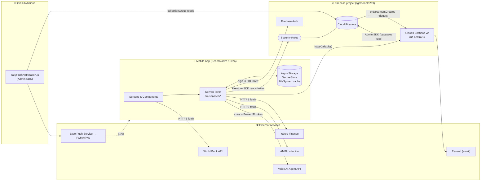
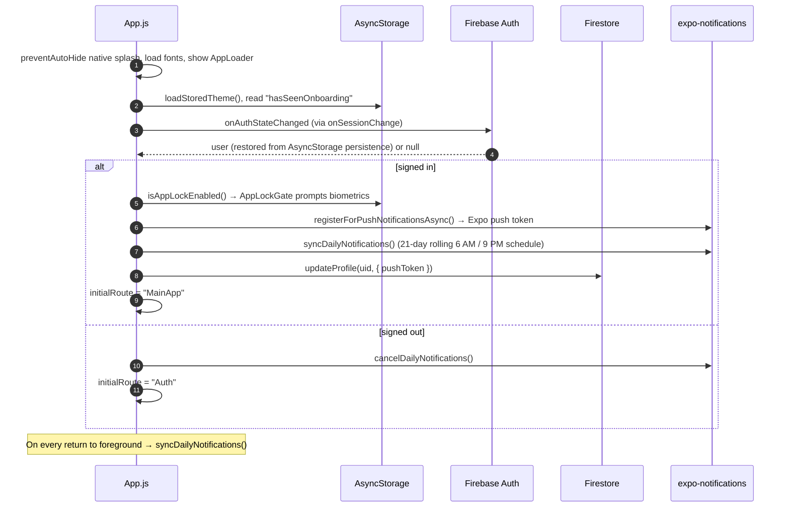
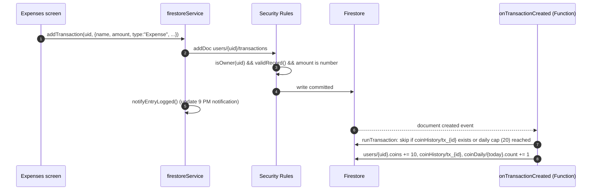
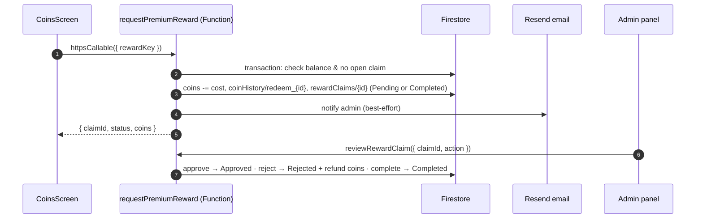

# 💡 LigthsON - Smart Personal Finance & Investment Platform

**LigthsON** is a comprehensive, feature-rich personal finance, investment tracking, and wealth management mobile application built with **React Native** and **Expo**. Designed with an intuitive interface, gamified progress tracking, and AI capabilities, LigthsON helps users build financial discipline, track daily expenses, manage investments, and achieve Financial Independence.

---

## 📑 Contents

1. [Key Features](#-key-features)
2. [Tech Stack](#️-tech-stack)
3. [System Architecture](#️-system-architecture)
   - [High-level overview](#31-high-level-overview)
   - [Application layers](#32-application-layers)
   - [Navigation tree](#33-navigation-tree)
   - [App boot & authentication](#34-app-boot--authentication)
4. [Database Architecture (Cloud Firestore)](#️-database-architecture-cloud-firestore)
   - [Data model](#41-data-model)
   - [How the app talks to the database](#42-how-the-app-talks-to-the-database)
   - [Key data flows](#43-key-data-flows)
   - [Security rules](#44-security-rules)
5. [Cloud Functions (server)](#️-cloud-functions-server)
6. [External Integrations](#-external-integrations)
7. [Notifications Architecture](#-notifications-architecture)
8. [On-device Storage](#-on-device-storage)
9. [Project Structure](#-project-structure)
10. [Getting Started](#-getting-started)
11. [Configuration & Secrets](#️-configuration--secrets)
12. [Deploying the Backend](#️-deploying-the-backend)
13. [Building the App](#-building-the-app)

---

## 🌟 Key Features

### 📊 1. Expense & Income Management
* **Interactive Calendar Dashboard:** Visualize daily incomes and expenses at a glance (`CalendarMain`, `DateExpenses`).
* **Categorized Transactions:** Log, organize, and inspect recurring and one-off income/expense entries.
* **Smart Filtering & Summaries:** Instant visibility into daily, weekly, and monthly cash flow.

### 📈 2. Investment Suite & Financial Calculators
* **🔥 FIRE Number Calculator:** Estimate the portfolio target required for Financial Independence & Early Retirement, with progress valued at live market prices.
* **📊 Mutual Fund Tracker & Calculator:** SIP and lumpsum projections with daily NAVs from AMFI / mfapi.in.
* **📈 Stock Portfolio, Watchlist & Technical Analysis:** Search NSE/BSE stocks, view live quotes and historical charts, track holdings and a watchlist.
* **🚀 Breakout Signals:** Coin-gated daily breakout stock list.
* **🏦 FD & RD Calculators:** Maturity amounts and interest growth.
* **🎯 Goal & PPP Calculators:** Savings goal tracker and Purchasing Power Parity adjustments.
* **💼 Wealth Dashboard:** One live view of all holdings (stocks, MFs, FD, RD, savings).

### 🎮 3. Gamification & Rewards System
* **Coins & Badges:** Earn coins for logging entries and opening the app daily; lose coins for inactivity (`CoinsScreen`, `BadgesScreen`).
* **Premium Rewards:** Redeem coins for a stock recommendation or a free consultation call; claims are reviewed by an admin.

### 🤖 4. AI-Powered Assistants
* **Voice Agent:** Log transactions and ask questions about your finances by voice or text (dock mic button → `VoiceAgentAddonWidget`).
* **Ligths Notes:** Daily notes with voice recording (`NoteAIScreen`).

### 📄 5. Analytics & Financial Reports
* Visual breakdowns of income vs. expense distribution and cash-flow insights.
* Exportable PDF reports for custom date ranges (`expo-print` + `expo-sharing`).

### 🔐 6. App Lock
* Optional biometric / device-PIN lock using the phone's own screen lock (`expo-local-authentication`). Re-locks after 30 s in the background.

### 🔔 7. Notifications
1. **🌅 Morning Motivation (6:00 AM IST)** and **🌙 Daily Check (9:00 PM IST)** — scheduled **on the device** as local notifications.
2. **📆 Due-date reminders** for recurring expenses, FD maturity, RD and SIP instalments — **2 days before** and **on the due date**, sent as push notifications by a GitHub Actions job.

---

## 🛠️ Tech Stack

| Layer | Technology |
|---|---|
| **Mobile client** | React Native 0.81, React 19.1, Expo SDK 54 (dev-client / EAS builds), React Navigation 7 (stack + bottom tabs) |
| **UI** | Custom "Pulse" design system (`src/components/pulse`, `src/theme`), `react-native-svg`, `react-native-chart-kit`, `lottie-react-native`, `react-native-calendars`, Space Grotesk + JetBrains Mono fonts, light/dark themes |
| **Auth** | Firebase Authentication (email/password; username login resolved server-side), session persisted with AsyncStorage |
| **Database** | Cloud Firestore (Firebase JS SDK v12 on the client, Admin SDK on the server) |
| **Server logic** | Firebase Cloud Functions v2 (Node 20, region `us-central1`) |
| **Scheduled jobs** | GitHub Actions + Node.js scripts using the Firebase Admin SDK and Expo Server SDK |
| **Push / local notifications** | `expo-notifications` (local scheduling + Expo Push tokens), Expo Push Service → FCM/APNs |
| **Market data** | Yahoo Finance chart API (stocks & indices), AMFI NAV file + mfapi.in (mutual funds), World Bank API (PPP) |
| **AI voice** | External Voice AI Agent REST API (`api.robxinnovations.in`), `expo-av` recording, `expo-speech` TTS |
| **Device security** | `expo-local-authentication` (app lock), `expo-secure-store` (security PIN in OS keychain) |
| **Email** | Resend API (admin alerts for reward claims, from Cloud Functions) |

---

## 🏗️ System Architecture

### 3.1 High-level overview

LigthsON is a **serverless, client-heavy** application. The mobile app talks **directly** to Firebase (Auth + Firestore) through the Firebase JS SDK; there is no custom REST backend in the main data path. Anything that must be trusted (coins, rewards, username lookup) runs in **Cloud Functions**, and Firestore **security rules** enforce what the client may write. Market data is fetched by the app directly from public APIs.



### 3.2 Application layers

| Layer | Location | Responsibility |
|---|---|---|
| **Entry & navigation** | `index.js`, `App.js`, `src/navigation/navigationRef.js` | Registers the root component, loads fonts/theme, listens to auth state, builds the navigator tree, mounts `AppLockGate` and the voice widget. |
| **Screens** | `src/screens/<feature>/` | Feature UIs: `auth`, `calendar`, `transactions`, `investments`, `wealth`, `profile`, `reports`, `ai`. |
| **Components** | `src/components/` | Shared UI (`pulse/` design system, charts, report modals, `VoiceAgentAddonWidget`, `AppLockGate`, `StockTracker`). |
| **Theme** | `src/theme/` | Design tokens (`P` palette), `themedStyles()`, `ThemeProvider` (light/dark, persisted). |
| **Hooks** | `src/hooks/useLiveRefresh.js` | Refresh-on-focus and per-minute refresh while the NSE market is open. |
| **Services (data access)** | `src/services/` | **Every** network / database call lives here. Screens never build Firestore paths themselves (exception: `calendarmain.js` reads `breakout_history`). |
| **Config** | `src/config/FirebaseConfig.js`, `src/config/api.js` | Firebase app/auth/db/functions singletons; base URLs for the Voice API (and the legacy REST backend). |
| **Utilities** | `src/utils/` | Session helpers (`secureStorage.js`), formatters, F.I.R.E. progress math (`fireProgressHelper.js`), safe TTS. |
| **Static data** | `src/data/` | Indian stock master list, motivation quotes, PPP reference data. |
| **Server** | `functions/index.js` | Cloud Functions (coin economy, rewards, username login). |
| **Ops scripts** | `scripts/` | Push-notification job, one-time security migration, design codemods. |

**Service map**

| Service | Talks to | Purpose |
|---|---|---|
| `firestoreService.js` | Firestore | Central CRUD for profile, transactions, investments, goals, stock portfolio, watchlist, coin history, cached mutual funds. |
| `firebaseAuthService.js` | Firebase Auth + Firestore | Register (profile + username reservation in one batch), login, password reset, logout, username availability. |
| `secureFunctions.js` | Cloud Functions (callable) | `dailyCheckIn`, `requestPremiumReward`, `lookupLoginEmail`. |
| `premiumRewardsService.js` | Firestore | Reads the user's `rewardClaims`. |
| `breakoutService.js` | Firestore | Reads `breakout_history`, applies the 10,000-coin unlock rule. |
| `livePriceService.js` | Yahoo Finance, mfapi.in | Quote/NAV fetching with in-memory TTL caches (60 s quotes, 30 min NAVs); values holdings. |
| `portfolioLive.js` | `firestoreService` + `livePriceService` | Single shared live portfolio feed used by Home, Wealth, F.I.R.E., Goals and Stocks screens. |
| `marketIndices.js` | Yahoo Finance | NIFTY 50 / SENSEX / BANK NIFTY ticker (5 s while market open, 60 s otherwise). |
| `yahooFinanceService.js`, `realStockDataService.js` | Yahoo Finance | Quotes, multi-quotes, historical chart data (with local master-list fallback). |
| `mutualFundApiService.js` | AMFI NAV file, mfapi.in | Fund catalogue (cached on device for 6 h) and scheme details. |
| `technicalAnalysisService.js` | — (pure math) | SMA/SMMA and other indicators for stock charts. |
| `simpleReportService.js` | Firestore → `expo-print` | Builds PDF reports from the user's transactions. |
| `voiceAgentService.js` | Voice AI Agent API | Audio/text conversation, transaction confirmation, finance Q&A, RAG queries. |
| `notificationService.js`, `dailyNotifications.js` | `expo-notifications`, Firestore (count query) | Push-token registration; on-device 6 AM / 9 PM schedule. |
| `appLock.js` | `expo-local-authentication`, AsyncStorage | App-lock preference and OS unlock prompt. |

### 3.3 Navigation tree

```
NavigationContainer (themed, key = theme mode)
└── MainStack
    ├── Auth (AuthStack)
    │   ├── Onboarding          (first launch only — AsyncStorage "hasSeenOnboarding")
    │   ├── SplashScreen
    │   ├── Login
    │   ├── SignUp
    │   └── ForgotPassword
    ├── MainApp (Bottom tabs, custom "PulseDock")
    │   ├── Calendar  → CalendarStack: CalendarMain, DateExpenses, Income, Expenses,
    │   │                ReportScreen, NoteAIScreen, + investment screens*
    │   ├── Wealth    → WealthStack: WealthHome, + investment screens*
    │   ├── AIVoice   → (dummy tab; the mic button opens VoiceAgentAddonWidget)
    │   ├── Plan      → PlanStack: FireNumber ⇄ Goals (segmented header)
    │   └── Profile   → MeStack: ProfileHome, NoteAIScreen, ReportScreen, Coins, MyRewardClaims
    ├── Coins
    └── MyRewardClaims

* investment screens: Investment, AddInvestment, FDScreen, RDScreen, MFPortfolio, MFScreen,
  MFCalculator, StocksScreen, BreakoutStocksScreen, StockSearch, StockDetail, SavingsScreen
```

### 3.4 App boot & authentication



**Registration** (`firebaseAuthService.registerUser`)
1. `createUserWithEmailAndPassword` creates the Auth user.
2. A single **write batch** creates `users/{uid}` and `usernames/{userName}`. The rules use `getAfter()` to require both docs to agree, which makes usernames unique.
3. If the batch fails (e.g. username taken in a race), the Auth user is deleted again.
4. The optional security PIN is stored only on the device via `expo-secure-store` (never in Firestore).

**Login** — by email directly, or by username: the app calls the `lookupLoginEmail` Cloud Function to resolve the email server-side (clients cannot query `users`), then signs in with `signInWithEmailAndPassword`.

---

## 🗄️ Database Architecture (Cloud Firestore)

### 4.1 Data model

All per-user data lives **under the user's own document**, so ownership is enforced by path. Shared/global collections are read-only to clients.

```
Firestore
├── users/{uid}                              ← profile (owner read / limited write)
│   ├── transactions/{txId}                  ← income, expense, investment mirror entries
│   ├── investments/{invId}                  ← FD, RD, Mutual Fund, Stock, Savings
│   ├── goals/{goalId}
│   ├── stockPortfolio/{id}
│   ├── watchlist/{SYMBOL}                   ← doc id = sanitized ticker (no duplicates)
│   ├── coinHistory/{key}                    ← server-only ledger (idempotency key = doc id)
│   ├── coinDaily/{YYYY-MM-DD}               ← server-only daily reward counter
│   ├── badgeAwards/{id}                     ← server-only
│   └── premiumRewardRedemptions/{id}        ← server-only
├── usernames/{userName}                     ← { uid } unique-username index
├── admins/{uid}                             ← admin allow-list (console / migration script only)
├── rewardClaims/{claimId}                   ← premium reward requests (server-only writes)
├── breakout_history/{id}                    ← daily breakout signals (external pipeline)
├── mutualFunds/{schemeCode}                 ← cached NAVs (external pipeline)
└── system/notificationState                 ← push-job bookkeeping (Admin SDK only)
```

**Main document shapes**

| Path | Key fields | Written by |
|---|---|---|
| `users/{uid}` | `uid`, `email`, `userName`, `firstName`, `lastName`, `age`, `retirementAge`, `phoneNumber`, `country`, `pushToken`, `lastBreakoutUnlock`, `createdAt`, **`coins`**, **`lastSeenDate`** | Client (profile fields only) · Functions (`coins`, `lastSeenDate`) |
| `…/transactions/{id}` | `name`, `amount` (number), `type` (`Income` / `Expense` / `Investment`), `subType`, `method`, `date` (`YYYY-MM-DD`), `isRecurring`, `recurringType`, `recurringMonths`, `noReward`, `createdAt`, `updatedAt` | Client |
| `…/investments/{id}` | `investmentType` (`Fixed Deposit`, `Recurring Deposit`, `Mutual Fund`, `Stock`, `Savings`), `name`, `amount`, `currentAmount`, `startDate`, `maturityDate`, type-specific fields (e.g. `symbol`, `exchange`, `quantity`, `schemeCode`, `calculationType`), `createdAt` | Client |
| `…/goals/{id}` | goal fields, `createdAt`, `updatedAt` | Client |
| `…/watchlist/{SYMBOL}` | `symbol`, `name`, `exchange`, `note`, `targetPrice`, `plannedQty`, `addedPrice`, `updatedAt` | Client |
| `…/coinHistory/{key}` | `action`, `points`, `description`, `timestamp` | Functions |
| `rewardClaims/{id}` | `claimId`, `uid`, `fullName`, `email`, `phone`, `rewardType`, `rewardName`, `coinsRequired`, `currentCoins`, `status` (`Pending` → `Approved` → `Completed` / `Rejected`), timestamps, reviewer fields | Functions |

> Adding an FD/RD/MF also writes a mirror entry into `transactions` with `type: "Investment"` so it shows on the calendar. The coin trigger ignores these (investments are rewarded through the `investments` trigger instead).

### 4.2 How the app talks to the database

There are **four communication channels** to Firestore:

| # | Channel | Who | Auth / authorization | Used for |
|---|---|---|---|---|
| 1 | **Firestore JS SDK** (`getDoc`, `getDocs`, `addDoc`, `updateDoc`, `setDoc`, `deleteDoc`, `writeBatch`, `getCountFromServer`) | Mobile app, via `src/services/*` | Firebase Auth ID token attached automatically; every request checked by `firestore.rules` | All user CRUD: profile, transactions, investments, goals, stocks, watchlist; reading coin history, claims, breakout & MF caches |
| 2 | **Callable Cloud Functions** (`httpsCallable`) | Mobile app, via `secureFunctions.js` | ID token verified by Firebase; optional App Check (`ENFORCE_APP_CHECK`) | Trusted operations: daily check-in, reward redemption, username → email lookup, admin claim review |
| 3 | **Firestore triggers** (`onDocumentCreated`) | Cloud Functions, automatically | Admin SDK (bypasses rules) | Awarding coins when a transaction / investment is created |
| 4 | **Admin SDK scripts** | GitHub Actions job, migration script | Service-account credentials | Due-date push reminders (collection-group reads), one-time data migrations |

**Read pattern.** Reads are one-shot fetches (`getDocs`), not realtime `onSnapshot` listeners. Screens refresh on focus (`useFocusEffect`). Cross-screen freshness is handled in-app:

* `firestoreService` emits a `portfolioChanged` event (`react-native-event-listeners`) after any investment add/update/delete.
* `portfolioLive.js` listens for that event, reloads the investment list, and re-prices it; all subscribed screens get the same snapshot at the same time.
* Writes to transactions/investments call `notifyEntryLogged()` so tonight's 9 PM local notification reflects whether the user logged anything.

**Write pattern.** Writes go through `firestoreService` helpers, which normalise numbers (`parseFloat(amount)`) and stamp `serverTimestamp()` for `createdAt` / `updatedAt`. `updateProfile` whitelists editable fields client-side, mirroring the rules.

**Queries & indexes.** Queries are single-field (`orderBy("date")`, `where("investmentType", "==", …)`, `where("uid", "==", …)`), so no composite indexes are needed (`firestore.indexes.json` is empty). Reward claims are sorted client-side to avoid a composite index.

### 4.3 Key data flows

**Logging an expense → coins**



**Daily check-in** — `CalendarMain` calls `dailyCheckIn()` on focus. The client de-duplicates calls per user per IST day; the function, in one transaction, awards +5 coins once per IST day and applies a −500 penalty (never below zero) if days were missed, then sets `lastSeenDate`.

**Premium reward redemption**



**Live portfolio valuation** — `portfolioLive.refreshPortfolio()` loads `users/{uid}/investments`, groups stock tickers (`INFY` → `INFY.NS` / `.BO`) and MF scheme codes, fetches quotes/NAVs through `livePriceService` (cached 60 s / 30 min), values each holding, and emits one shared state. It polls every 1 min while NSE is open and every 15 min otherwise, pauses when the app is backgrounded or nothing is subscribed.

**Breakout signals** — `breakoutService` reads the latest `breakout_history` session (data lands after 5 PM IST). Rules only allow the read if the user's `coins >= 10000`; unlocking stores `lastBreakoutUnlock` on the profile so the list stays open for that trading day.

**Voice agent** — The dock mic opens `VoiceAgentAddonWidget` → records audio (`expo-av`) or takes text → `voiceAgentService` posts to the Voice API with `Authorization: Bearer <Firebase ID token>` → the API returns a parsed transaction / answer → the user confirms → `confirmTransaction` asks the Voice API to persist it → reply is spoken with `expo-speech`. The Voice API is an external service; it verifies the ID token and owns its own persistence.

**Reports** — `simpleReportService` fetches transactions with `getTransactions(uid)`, filters by date range on the device, renders HTML → PDF with `expo-print`, and shares it with `expo-sharing`.

### 4.4 Security rules

`firestore.rules` is **deny-by-default**. Summary:

| Data | Read | Write |
|---|---|---|
| `users/{uid}` | Owner, admins | Owner: create once (must match Auth email and reserved username); update only name, age, retirement age, phone, country, push token, `lastBreakoutUnlock`. **Never** `coins`, `email`, `userName`, `lastSeenDate`. No delete. |
| `transactions`, `investments`, `goals`, `stockPortfolio` | Owner | Owner, ≤ 60 fields, `amount` numeric and bounded |
| `watchlist/{symbol}` | Owner | Owner, whitelisted fields, doc id must equal `symbol` |
| `coinHistory`, `badgeAwards`, `premiumRewardRedemptions`, `coinDaily` | Owner (not `coinDaily`) | Functions only |
| `usernames/{name}` | Anyone, single `get` (no listing) | Created once, in the same batch as the profile |
| `rewardClaims` | Claim owner, admins | Functions only |
| `breakout_history` | Signed-in users with ≥ 10,000 coins | Server only |
| `mutualFunds` | Signed-in users | Server only |
| `admins/{uid}` | That admin | Console / migration script only |
| Cloud Storage | Nobody | Nobody (`storage.rules`, not used) |

See [SECURITY.md](SECURITY.md) for the full threat model and deployment checklist.

---

## ☁️ Cloud Functions (server)

Defined in `functions/index.js` (Node 20, `firebase-functions` v2, region `us-central1`, max 10 instances). These are the **only** code paths that change coins.

| Function | Type | What it does |
|---|---|---|
| `onTransactionCreated` | Firestore trigger `users/{uid}/transactions/{txId}` | +10 coins for income/expense (skips `noReward` and `Investment` entries); idempotent per doc; max 20 rewarded logs per IST day |
| `onInvestmentCreated` | Firestore trigger `users/{uid}/investments/{invId}` | +15 Savings, +20 FD/RD, +25 MF/SIP/Stock; same idempotency and cap |
| `dailyCheckIn` | Callable | +5 coins once per IST day; −500 inactivity penalty when days were missed |
| `requestPremiumReward` | Callable | Atomically deducts coins and creates a `rewardClaims` doc; emails the admin via Resend |
| `reviewRewardClaim` | Callable (admin only) | Approve / reject (refund) / complete a claim |
| `lookupLoginEmail` | Callable | Resolves a username to its sign-in email via `usernames/` (with legacy fallback) |

Admin is determined by an `admin` custom claim **or** a document at `admins/{uid}`.

---

## 🌐 External Integrations

| Service | Endpoint(s) | Used by | Notes |
|---|---|---|---|
| Yahoo Finance | `query1/query2.finance.yahoo.com/v8/finance/chart/…` | `yahooFinanceService`, `marketIndices`, `realStockDataService`, `livePriceService` | No API key; host failover between query1/query2 |
| AMFI | `portal.amfiindia.com/spages/NAVAll.txt` | `mutualFundApiService` | Full NAV catalogue, cached on device |
| mfapi.in | `api.mfapi.in` | `mutualFundApiService`, `livePriceService` | Scheme details & latest NAV |
| World Bank | `api.worldbank.org/v2/…/PA.NUS.PPP` | `PPPCalculator` | PPP conversion factors |
| Voice AI Agent | `api.robxinnovations.in/api/voice` (`/agent/process-text`, `/token`, `/categories`, `/health`, …) | `voiceAgentService` | Firebase ID token as Bearer auth |
| Expo Push Service | via `expo-server-sdk` | `scripts/dailyPushNotification.js` | Delivers to FCM / APNs |
| Resend | `api.resend.com/emails` | Cloud Functions | Admin email on reward requests |
| Google Calendar | `calendar.google.com/calendar/render` | `AdvisorBooking` | Opens a pre-filled event link |

> **Legacy:** `src/config/api.js` still lists the old REST backend (`ligths-backend.onrender.com`). Only `reportService.js` and `stockCRUDService.js` reference it, and neither is imported by any screen — all live data now goes through Firebase.

---

## 🔔 Notifications Architecture

| Notification | Where it's produced | Mechanism |
|---|---|---|
| 6:00 AM motivation quote | Device (`dailyNotifications.js`) | Local notifications scheduled for a rolling 21-day window; quotes don't repeat until all are used |
| 9:00 PM daily check | Device (`dailyNotifications.js`) | Local notification; text depends on whether today has entries (Firestore `getCountFromServer`) |
| Welcome | Device (`App.js`) | One-time local notification per account per device |
| Due-date reminders (expenses, FD, RD, SIP) | GitHub Actions → `scripts/dailyPushNotification.js` | Runs 00:30 UTC (06:00 IST); reads `users` + `collectionGroup("transactions" / "investments")` with the Admin SDK; sends to stored `pushToken`s via Expo Push |

The morning/evening messages moved from GitHub Actions to on-device scheduling because scheduled workflows often run late or are skipped. `.github/workflows/push-notification-3-categories.yml` allows sending any category manually.

---

## 💾 On-device Storage

| Store | Keys / files | Content |
|---|---|---|
| AsyncStorage | Firebase Auth persistence | Signed-in session |
| AsyncStorage | `hasSeenOnboarding`, theme, `appLockEnabled`, `welcomeNotified:{uid}`, `dailyNotifications.v1`, `userInfo` | Preferences & cached profile |
| AsyncStorage | `notes_{date}`, `hasSeenNotesIntro` | Ligths Notes content (local only) |
| SecureStore (OS keychain) | `securityPin_{uid}` | Security PIN — never sent to the server |
| FileSystem | `mf_catalog_v3.json` | Mutual fund catalogue cache (6 h TTL) |
| In-memory | quote / NAV `Map` caches | Live prices (60 s / 30 min TTL) |

---

## 📁 Project Structure

```
ligths-main/
├── .github/workflows/
│   ├── daily-notification.yml            # Scheduled due-date reminders (06:00 IST)
│   ├── push-notification-3-categories.yml# Manual push of any category
│   └── main.yml                          # Legacy (disabled)
├── assets/                               # Brand icons, splash, reference data
├── animations/                           # Lottie animations
├── functions/                            # Firebase Cloud Functions (Node 20)
│   ├── index.js                          # Coins, rewards, check-in, username login
│   └── .env.example                      # RESEND_*, ADMIN_NOTIFICATION_EMAIL, ENFORCE_APP_CHECK
├── scripts/
│   ├── dailyPushNotification.js          # Push reminder job (Admin SDK + Expo SDK)
│   ├── motivationQuotes.js               # Quote collection
│   └── securityMigration.js              # One-time usernames/admins/PIN migration
├── src/
│   ├── components/                       # Shared UI, pulse/ design system, brand/, voice widget
│   ├── config/                           # FirebaseConfig.js, api.js
│   ├── data/                             # Stock master list, quotes, PPP data
│   ├── hooks/                            # useLiveRefresh
│   ├── navigation/                       # navigationRef
│   ├── screens/
│   │   ├── ai/                           # Ligths Notes
│   │   ├── auth/                         # Onboarding, Splash, Login, Register, Forgot Password
│   │   ├── calendar/                     # Home calendar & day view
│   │   ├── investments/                  # FIRE, Goals, MF, Stocks, Breakouts, FD/RD, Savings
│   │   ├── profile/                      # Profile, Coins, Badges, Reward claims
│   │   ├── reports/                      # Financial reports
│   │   ├── transactions/                 # Income & Expense entry
│   │   └── wealth/                       # Wealth dashboard, MF portfolio
│   ├── services/                         # All Firestore / Functions / API access
│   ├── theme/                            # Tokens & ThemeProvider
│   └── utils/                            # Session, formatting, FIRE math
├── App.js                                # Root: boot, auth gate, navigation
├── firebase.json                         # Firebase deploy config (rules, indexes, functions)
├── firestore.rules                       # Firestore security rules
├── firestore.indexes.json                # Composite indexes (none required)
├── storage.rules                         # Cloud Storage locked down
├── app.json / eas.json                   # Expo manifest & EAS build profiles
└── SECURITY.md                           # Security model & deployment steps
```

---

## 🚀 Getting Started

### Prerequisites
* Node.js 20+ and npm
* An Android/iOS device or emulator. The app uses `expo-dev-client` and native modules, so use a development build (`npm run android` / `npm run ios`) rather than Expo Go for full functionality.
* Firebase CLI (`npm i -g firebase-tools`) for deploying rules and functions

### Installation

1. **Clone the repository:**
   ```bash
   git clone <repository-url>
   cd ligths-main
   ```

2. **Install dependencies:**
   ```bash
   npm install
   cd functions && npm install && cd ..
   ```

3. **Start the development server:**
   ```bash
   npx expo start
   ```

4. **Run on specific platforms:**
   * **Android:** `npm run android`
   * **iOS:** `npm run ios`
   * **Web:** `npm run web`

---

## ⚙️ Configuration & Secrets

### Firebase (client)
* Web SDK config lives in `src/config/FirebaseConfig.js` (project `ligthson-93799`).
* Place `google-services.json` in the project root for Android builds (git-ignored).

### Cloud Functions
Copy `functions/.env.example` to `functions/.env` (git-ignored) and set:
* `RESEND_API_KEY`, `RESEND_FROM_EMAIL`, `ADMIN_NOTIFICATION_EMAIL` — admin email alerts
* `ENFORCE_APP_CHECK` — set to `true` once App Check is integrated

### GitHub Actions
In **Settings → Secrets and variables → Actions**, add:
* `FIREBASE_SERVICE_ACCOUNT` — raw JSON of a Firebase service-account key.

### Voice API
Toggle `FORCE_PRODUCTION` in `src/config/api.js` to switch between the production Voice API and a local server.

> Never commit service-account keys (`*firebase-adminsdk*.json`) or `.env` files — they are covered by `.gitignore`.

---

## ☁️ Deploying the Backend

```bash
firebase deploy --only firestore:rules,firestore:indexes,storage   # security rules
firebase deploy --only functions                                    # Cloud Functions
```

First-time migration of existing data (creates `usernames/`, removes plaintext PINs and legacy admin flags, optionally creates `admins/`):

```bash
GOOGLE_APPLICATION_CREDENTIALS=/path/to/key.json node scripts/securityMigration.js            # dry run
GOOGLE_APPLICATION_CREDENTIALS=/path/to/key.json node scripts/securityMigration.js --apply --admins=you@example.com
```

---

## 📱 Building the App

* **Build Android APK (EAS):**
  ```cmd
  build-apk-eas.bat
  ```
  or directly:
  ```bash
  npx eas-cli build -p android --profile preview
  ```
  Profiles (`eas.json`): `development` (dev client), `preview` (internal APK), `production`.

---

## 📝 License

This project is private and proprietary. All rights reserved.
